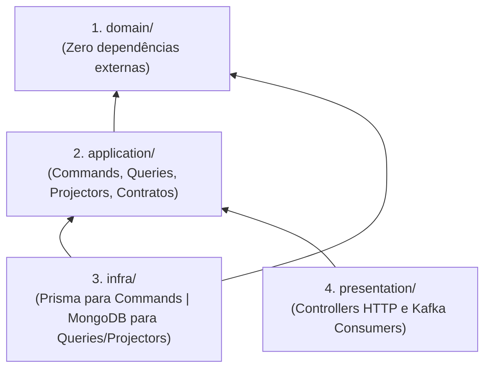
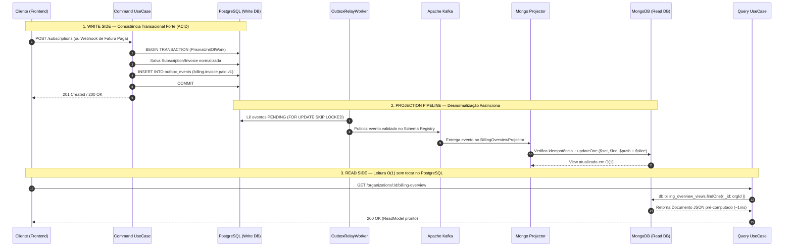
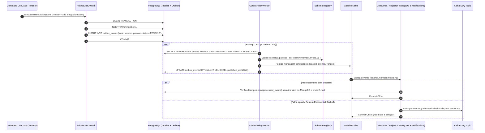

# SaaS Architecture Blueprint — NestJS Modular Clean Architecture & DDD

> **Propósito deste Documento:** Este blueprint é o guia arquitetural definitivo para a criação de um **Boilerplate SaaS Enterprise em NestJS**. Ele foi desenhado para ser utilizado tanto por desenvolvedores quanto por agentes de IA para construir novos projetos e módulos seguindo rigorosamente **DDD (Domain-Driven Design)**, **Clean Architecture**, **Hexagonal (Ports & Adapters)** e **SOLID**, com foco máximo em **Developer Experience (DX)**, **Resiliência** e **Alta Escalabilidade**.

---

## 1. Visão Geral e Princípios Inegociáveis

1. **Modularidade por Bounded Context (Vertical Slices)**: O código não é dividido na raiz por camadas técnicas genéricas (`controllers/`, `services/`, `repositories/`), mas sim por **Módulos de Negócio independentes** (`src/modules/<contexto>`).
2. **Domínio 100% Puro (`domain/`)**: A camada de domínio não conhece banco de dados, HTTP, Kafka, Redis ou bibliotecas externas.
3. **Separação Clara entre `domain` e `application`**:
   - **`domain/`**: O que o negócio **É** (Entidades, Agregados, Value Objects, Domain Services, Domain Factories, Eventos de Domínio e Regras Invariantes).
   - **`application/`**: O que o sistema **FAZ** (Use Cases divididos em Commands e Queries, Projectors, Contratos de Repositórios/Gateways, Subscribers e Facades).
4. **CQRS Poliglota Real (PostgreSQL no Write Side + MongoDB no Read Side)**:
   - **Commands (Escrita)**: Executam regras invariantes no `domain/`, persistem em tabelas normalizadas (3NF) no **PostgreSQL (via Prisma)** com transações ACID (`UnitOfWork`) e registram eventos na tabela `Outbox`.
   - **Projectors (Sincronização)**: Consomem os eventos publicados no **Apache Kafka** e atualizam documentos desnormalizados (**Read Models / Views**) no **MongoDB** usando operadores atômicos (`$set`, `$inc`, `$push`).
   - **Queries (Leitura)**: Consultam exclusivamente o **MongoDB** (e **Redis** quando aplicável), retornando o JSON pronto em `O(1)` sem `JOIN`s e **retirando 100% da carga de leitura do PostgreSQL**.
5. **Encapsulamento Estrito entre Módulos**: Um módulo **jamais** importa o `Repository`, `UseCase` ou `Entity` de outro módulo. A comunicação entre módulos ocorre exclusivamente via:
   - **Facades** (Comunicação síncrona/consulta pontual, usando contratos em `src/shared/contracts`).
   - **Integration Events via Outbox + Kafka** (Comunicação assíncrona/reativa e atualização de Read Models cross-module no MongoDB).
6. **Proteção contra Terceiros (Gateway + ACL + Resiliência)**: Toda integração externa vive em `src/integrations/`, protegida por uma **Anti-Corruption Layer (ACL)**, **Circuit Breaker**, **Retry com Exponential Backoff + Jitter** e **Timeout**.
7. **Erros como Valores (`Either` Pattern)**: Casos de uso nunca lançam exceções (`throw`) para erros de negócio esperados. Eles retornam `Either<DomainError, Result>`, e um filtro global na camada HTTP converte erros de domínio em respostas HTTP internacionalizadas (`pt-BR` / `en`).

---

## 2. Tech Stack & Bibliotecas Padronizadas

| Categoria | Tecnologia / Biblioteca | Papel na Arquitetura |
| :--- | :--- | :--- |
| **Runtime & Framework** | Node.js LTS + **NestJS 10/11** + `@nestjs/platform-fastify` | Core do servidor HTTP de alta performance com Fastify. |
| **Validação & OpenAPI** | **Zod** + `nestjs-zod` + `@scalar/nestjs-api-reference` | Single Source of Truth: um único schema Zod valida o request e gera a documentação interativa no **Scalar API**. |
| **Write DB (Commands)** | **PostgreSQL 16+** + **Prisma ORM** | Fonte da verdade transacional (ACID), modelos normalizados, `UnitOfWork` e tabela de `Outbox`. |
| **Read DB (Queries / CQRS)** | **MongoDB 7+** (`mongodb` driver nativo) | Armazenamento de **Read Models (Views desnormalizadas)** alimentadas via Kafka para leituras ultra-rápidas, filtros dinâmicos e agregações sem onerar o PostgreSQL. |
| **In-Memory & Locks** | **Redis 7+** (`ioredis` / `@liaoliaots/nestjs-redis`) | Sessões/Refresh Tokens, Rate Limit distribuído, Locks distribuídos, controle de idempotência rápida e cache de curtíssima duração. |
| **Mensageria & Eventos** | **Apache Kafka** (`kafkajs`) + `@confluentinc/schemaregistry` | Event-Driven Architecture + Backbone do CQRS com **Transactional Outbox Pattern**, **Event Versioning**, **Schema Registry** e **DLQ (Dead Letter Queue)**. |
| **Autenticação & Cripto** | `@nestjs/jwt` + **Argon2** (`argon2`) | Hashing de senhas resistente a GPU (Argon2id) e tokens JWT assimétricos (RS256/EdDSA). |
| **Autorização (Dynamic ABAC)** | **CASL** (`@casl/ability`) | Motor de permissões dinâmicas: usuários criam cargos customizados por organização com regras e condições de atributos (JSON hidratado em runtime + cargo `Owner` de sistema imutável). |
| **Resiliência** | `nestjs-resilience` / `cockatiel` + `@nestjs/throttler` | **Circuit Breaker**, **Retry (Exponential Backoff + Jitter)**, **Timeout** e **Rate Limiting Distribuído** (via Redis). |
| **Observabilidade** | `@nestjs/observe` (`nestjs/observe`) + `nestjs-pino` + OpenTelemetry SDK + Prometheus | `@nestjs/observe` em produção combinado com logs estruturados em JSON (`nestjs-pino`), Distributed Tracing (OTel: HTTP → Prisma → Kafka → MongoDB) e métricas Prometheus (`/metrics`). |
| **Internacionalização** | `nestjs-i18n` | Tradução dinâmica (`en` e `pt-BR`) via header `Accept-Language` para erros, validações e e-mails. |
| **E-mail** | `@nestjs-modules/mailer` (`nodemailer`) + **Mailpit** (Dev) | Envio de e-mails transacionais com templates internacionalizados e caixa de entrada local no Mailpit. |
| **Storage** | `@aws-sdk/client-s3` + `@aws-sdk/s3-request-presigner` | Abstração de Object Storage (AWS S3 / Cloudflare R2 / MinIO) com suporte a Presigned URLs. |
| **Testes** | **Vitest** + `supertest` + `@faker-js/faker` | Testes Unitários (In-Memory), Integração e E2E com schemas isolados no PostgreSQL e databases isolados no MongoDB por worker. |
| **Code Quality & Git** | **Biome** + **Ultracite** + **Lefthook** | Linter/Formatter ultra-rápido em Rust (Biome + preset Ultracite) e Git Hooks automatizados (Lefthook). |
| **Infra Dev** | **Docker** & **Docker Compose** | Orquestração local de PostgreSQL, MongoDB, Redis, Kafka (KRaft) + Schema Registry, Mailpit, MinIO e OpenTelemetry Collector. |

---

## 3. Estrutura de Diretórios Completa

```text
saas-boilerplate/
├── docker/                                      # Configurações de containers auxiliares (OTel, Kafka, etc.)
├── prisma/
│   ├── schema.prisma                            # Schema do banco (Modelos + Tabela OutboxEvent)
│   ├── migrations/
│   └── seed.ts
├── src/
│   ├── shared/                                  # Camada transversal agnóstica aos domínios de negócio
│   │   ├── core/                                # Blocos de construção do DDD (Zero dependências de framework)
│   │   │   ├── domain/
│   │   │   │   ├── entity.ts
│   │   │   │   ├── aggregate-root.ts
│   │   │   │   ├── value-object.ts
│   │   │   │   ├── watched-list.ts
│   │   │   │   └── unique-entity-id.ts
│   │   │   ├── events/
│   │   │   │   ├── domain-event.ts              # Eventos internos em memória (mesmo módulo)
│   │   │   │   ├── domain-events.ts
│   │   │   │   └── integration-event.ts         # Contrato base de evento versionado p/ Outbox/Kafka
│   │   │   ├── logic/
│   │   │   │   └── either.ts                    # Left / Right para retorno funcional de Use Cases
│   │   │   └── errors/
│   │   │       ├── domain-error.ts              # Base error com code, i18nKey e metadata
│   │   │       └── common-errors.ts             # ResourceNotFoundError, NotAllowedError, ConcurrencyError
│   │   │
│   │   ├── contracts/                           # Contratos públicos ENTRE módulos (Evita dependência circular)
│   │   │   ├── facades/
│   │   │   │   ├── iam.facade.contract.ts
│   │   │   │   ├── tenancy.facade.contract.ts
│   │   │   │   └── billing.facade.contract.ts
│   │   │   └── events/                          # Schemas & Tipagens de Integration Events (v1, v2)
│   │   │       ├── tenancy/
│   │   │       │   └── member-invited.v1.event.ts
│   │   │       └── billing/
│   │   │           └── subscription-paid.v1.event.ts
│   │   │
│   │   ├── application/                         # Portas globais para a camada de Aplicação
│   │   │   ├── gateways/
│   │   │   │   ├── cache.gateway.ts
│   │   │   │   ├── cryptography.gateway.ts
│   │   │   │   ├── storage.gateway.ts
│   │   │   │   ├── mail.gateway.ts
│   │   │   │   └── event-bus.gateway.ts
│   │   │   ├── pagination/
│   │   │   │   └── pagination-params.ts
│   │   │   └── unit-of-work.ts                  # Contrato para transações atômicas + persistência do Outbox
│   │   │
│   │   └── infra/                               # Implementações técnicas compartilhadas
│   │       ├── config/                          # Validação de variáveis de ambiente com Zod
│   │       ├── database/
│   │       │   ├── prisma/                      # Write DB: PrismaService, PrismaUnitOfWork, OutboxRepository
│   │       │   └── mongodb/                     # Read DB (CQRS): MongoReadService, Índices de Views, BaseProjector
│   │       ├── cache/                           # RedisService, RedisCacheAdapter, DistributedLockService
│   │       ├── cryptography/                    # Argon2Hasher, JwtEncrypter
│   │       ├── auth/                            # Guards JWT, CASL AbilityFactory base, @CurrentUser, @CurrentTenant
│   │       ├── i18n/                            # Configuração nestjs-i18n + dicionários (locales/en, locales/pt-BR)
│   │       ├── observability/                   # OpenTelemetry setup, Pino Logger, CorrelationIdInterceptor
│   │       ├── resilience/                      # Decorators e Policies (CircuitBreaker, Retry, Timeout, RateLimit)
│   │       ├── messaging/                       # KafkaProducer, KafkaConsumer, SchemaRegistry, OutboxRelayWorker, DLQHandler
│   │       └── http/                            # Fastify adapters, GlobalDomainExceptionFilter, Scalar setup
│   │
│   ├── integrations/                            # Gateways Externos + Anti-Corruption Layer (ACL)
│   │   ├── payment/
│   │   │   ├── contracts/
│   │   │   │   └── payment.gateway.ts
│   │   │   ├── providers/
│   │   │   │   ├── stripe/
│   │   │   │   │   ├── stripe-payment.adapter.ts
│   │   │   │   │   └── stripe-acl.mapper.ts
│   │   │   │   └── asaas/
│   │   │   │       ├── asaas-payment.adapter.ts
│   │   │   │       └── asaas-acl.mapper.ts
│   │   │   ├── factories/
│   │   │   │   └── payment-gateway.factory.ts
│   │   │   └── payment-integration.module.ts
│   │   ├── storage/                             # S3 / R2 / MinIO Adapter
│   │   └── mail/                                # Nodemailer / Mailpit / SES Adapter + Templates
│   │
│   ├── modules/                                 # Bounded Contexts do SaaS
│   │   ├── iam/                                 # 1. Identity & Access Management
│   │   ├── tenancy/                             # 2. Organizations, Members, Invites & RBAC
│   │   ├── billing/                             # 3. Plans, Subscriptions, Invoices & Quotas
│   │   ├── notifications/                       # 4. In-App & Transactional Notifications
│   │   └── audit/                               # 5. Audit Logs & Security Trail
│   │
│   ├── app.module.ts
│   └── main.ts                                  # Bootstrap com FastifyAdapter, Scalar, Helmet, CORS
│
├── test/                                        # Utilitários globais de teste
│   ├── setup-unit.ts
│   ├── setup-e2e.ts                             # Cria schema isolado no Postgres, DB isolado no Mongo e limpa Redis
│   ├── factories/                               # Builders de entidades e Read Models para testes
│   └── fakes/                                   # Fake Gateways (FakePaymentGateway, FakeStorage, FakeEventBus)
├── biome.json                                   # Configuração Biome + Ultracite
├── lefthook.yml                                 # Git hooks (lint, typecheck, testes afetados)
├── docker-compose.yml                           # Ambiente completo de desenvolvimento
└── package.json
```

---

## 4. Anatomia Interna de Cada Módulo de Negócio (`src/modules/<contexto>`)

Todo módulo dentro de `src/modules/` segue exatamente a mesma estrutura interna previsível, separando fisicamente o lado de escrita (**PostgreSQL/Prisma**) do lado de leitura (**MongoDB Views**):

```text
src/modules/billing/
├── domain/                                      # O QUE O NEGÓCIO É (100% puro, sem I/O)
│   ├── entities/                                # AggregateRoots e Entities (Subscription, Plan, Invoice)
│   ├── value-objects/                           # Imutáveis com validação (Money, BillingPeriod, CouponCode)
│   ├── events/                                  # Domain Events internos (InvoiceCreatedDomainEvent)
│   ├── factories/                               # Criação complexa (SubscriptionDomainFactory)
│   ├── services/                                # Lógica entre 2+ entidades (ProrationCalculatorDomainService)
│   └── errors/                                  # Erros de negócio (PlanQuotaExceededError, InvalidCouponError)
│
├── application/                                 # O QUE O SISTEMA FAZ (Orquestração CQRS)
│   ├── repositories/                            # Contratos de Escrita (SubscriptionsRepository) e Leitura (BillingReadRepository)
│   ├── read-models/                             # Tipagens dos Documentos/Views de Leitura (BillingOverviewReadModel)
│   ├── facades/                                 # Implementação do BillingFacadeContract
│   ├── use-cases/
│   │   ├── commands/                            # Escrita no PostgreSQL (create-subscription, cancel-subscription)
│   │   └── queries/                             # Leitura no MongoDB (get-billing-overview.query.ts)
│   ├── projectors/                              # Sincronizadores Kafka -> MongoDB (billing-overview.projector.ts)
│   ├── subscribers/                             # Handlers de Domain Events e Integration Events de negócio
│   └── policies/                                # Definições CASL específicas do módulo (BillingAbility)
│
├── infra/                                       # DETALHES TÉCNICOS DO MÓDULO
│   └── persistence/
│       ├── prisma/                              # WRITE SIDE (PostgreSQL)
│       │   ├── repositories/                    # PrismaSubscriptionsRepository
│       │   └── mappers/                         # PrismaSubscriptionMapper (toDomain / toPrisma)
│       └── mongodb/                             # READ SIDE (MongoDB Views Desnormalizadas)
│           ├── repositories/                    # MongoBillingReadRepository
│           └── schemas/                         # Índices e validação da collection (billing_overview_views)
│
├── presentation/                                # PORTA DE ENTRADA (HTTP / Webhooks / Consumers)
│   ├── http/
│   │   ├── controllers/                         # CreateSubscriptionController, GetBillingOverviewController
│   │   ├── dtos/                                # Zod Schemas + createZodDto (nestjs-zod)
│   │   └── presenters/                          # SubscriptionPresenter (toHTTP)
│   └── consumers/                               # Kafka Controllers que delegam para Subscribers e Projectors
│
└── billing.module.ts                            # Declara providers internos e exporta APENAS o BillingFacadeContract
```

### Regras de Dependência entre Camadas



---

## 5. CQRS Poliglota Real & Comunicação Orientada a Eventos

Para garantir **alta escalabilidade real** e **retirar 100% da carga de leitura do banco de dados transacional**, este boilerplate não utiliza um "CQRS apenas de pastas" batendo no mesmo banco: ele implementa **CQRS Poliglota com separação física de bancos de dados**.

### 5.1. Divisão de Responsabilidades: PostgreSQL (Write) vs. MongoDB (Read)

| Aspecto | **Command Side (`PostgreSQL 16 + Prisma`)** | **Query Side (`MongoDB 7 + Driver Nativo`)** |
| :--- | :--- | :--- |
| **Objetivo Principal** | Garantir integridade transacional (ACID), invariantes de domínio e consistência forte. | Entregar leituras (`GET`) em `~1-3ms` com zero `JOIN`, suportando filtros ricos, ordenação dinâmica e agregações. |
| **Modelagem de Dados** | **3ª Forma Normal (3NF)**: Tabelas relacionais (`organizations`, `subscriptions`, `plans`, `invoices`, `outbox_events`). | **Query-First / Documentos Desnormalizados**: Collections como `billing_overview_views` e `organization_members_views` já no formato JSON exato da UI. |
| **Fluxo de Código** | `Controller` → `Command` → `AggregateRoot` → `PrismaRepository` + `UnitOfWork` (Salva entidade + `OutboxEvent`). | `Controller` → `Query` → `MongoReadRepository` (Busca direta por `_id` ou índice composto, sem instanciar Entidades). |
| **Atualização de Dados** | Síncrona dentro da transação ACID do PostgreSQL. | Assíncrona (milissegundos depois) via **Projectors** que escutam o **Apache Kafka** e executam `$set`, `$inc`, `$push`. |

### 5.2. Fluxo Completo: Command (Postgres) → Outbox/Kafka → Projector → Query (MongoDB)



### 5.3. Exemplo Prático de Projector + Read Model no MongoDB

Em vez de executar `JOIN` entre 4 tabelas no PostgreSQL a cada abertura de dashboard, o documento na collection `billing_overview_views` do MongoDB já armazena a visão consolidada:

```typescript
// src/modules/billing/application/read-models/billing-overview.read-model.ts
export interface BillingOverviewReadModel {
  _id: string // organizationId
  organizationName: string
  plan: {
    id: string
    name: string
    priceCents: number
    currency: string
    maxMembers: number
  }
  usage: {
    currentMembers: number
    storageUsedMb: number
  }
  subscriptionStatus: 'ACTIVE' | 'TRIALING' | 'PAST_DUE' | 'CANCELED'
  currentPeriodEnd: Date
  recentInvoices: Array<{
    id: string
    amountCents: number
    status: 'PAID' | 'OPEN' | 'FAILED'
    paidAt: Date | null
  }>
  version: number
  updatedAt: Date
}
```

Os **Projectors** reagem aos eventos do Kafka de **qualquer módulo** e aplicam mutações atômicas cirúrgicas no documento do MongoDB:

```typescript
// src/modules/billing/application/projectors/billing-overview.projector.ts
@Injectable()
export class BillingOverviewProjector {
  constructor(private readonly mongo: MongoReadService) {}

  // Quando um novo membro aceita convite no módulo Tenancy (Cross-Module Projection!)
  async onMemberAccepted(event: MemberAcceptedV1Payload): Promise<void> {
    await this.mongo.collection<BillingOverviewReadModel>('billing_overview_views').updateOne(
      { _id: event.organizationId },
      {
        $inc: { 'usage.currentMembers': 1, version: 1 },
        $set: { updatedAt: new Date() },
      },
    )
  }

  // Quando uma fatura é paga no módulo Billing
  async onInvoicePaid(event: InvoicePaidV1Payload): Promise<void> {
    await this.mongo.collection<BillingOverviewReadModel>('billing_overview_views').updateOne(
      { _id: event.organizationId },
      {
        $set: { subscriptionStatus: 'ACTIVE', updatedAt: new Date() },
        $inc: { version: 1 },
        $push: {
          recentInvoices: {
            $each: [event.invoiceSummary],
            $position: 0,
            $slice: 5, // Mantém automaticamente apenas as 5 últimas faturas embutidas no documento!
          },
        },
      },
    )
  }
}
```

### 5.4. Tratamento de Consistência Eventual (`Read-Your-Own-Writes`)
Como a sincronização `PostgreSQL → Outbox → Kafka → MongoDB` leva tipicamente entre `30ms` e `150ms`, aplicamos 3 padrões para que o usuário nunca perceba atraso na interface:
1. **Retorno Enriquecido no Command**: Quando o usuário cria um recurso (`POST`), o próprio Command retorna o `id` e o resumo imediato para a UI atualizar seu estado local (*Optimistic UI*).
2. **Idempotência e Ordenação por `version` / `occurredAt`**: Todo Projector valida se o evento recebido é mais recente que a versão do documento no MongoDB antes de aplicar mudanças, evitando sobrescritas fora de ordem.
3. **Rebuild de Views (Replayability)**: Como o PostgreSQL é a fonte da verdade e o Kafka retém os eventos, qualquer View do MongoDB pode ser recriada do zero ou ter novos campos adicionados a qualquer momento sem perda de dados.

---

### 5.5. Comunicação Síncrona entre Módulos no Write Side: `Facade Pattern`
Usado durante a execução de um **Command** quando o **Módulo A** precisa validar uma regra síncrona no **Módulo B** imediatamente antes de persistir no PostgreSQL.
- **Onde fica o contrato?** Em `src/shared/contracts/facades/<modulo>.facade.contract.ts`. Isso impede referências circulares entre módulos.
- **O que a Facade retorna?** Apenas **DTOs planos (primitivos)**, nunca Entidades de Domínio.

```typescript
// src/shared/contracts/facades/billing.facade.contract.ts
export interface QuotaCheckResultDTO {
  allowed: boolean
  limit: number
  currentUsage: number
  planName: string
}

export abstract class BillingFacadeContract {
  abstract checkFeatureQuota(params: {
    organizationId: string
    featureKey: 'max_members' | 'max_storage_mb'
    currentUsage: number
  }): Promise<QuotaCheckResultDTO>
}
```

### 5.6. Arquitetura Híbrida de Eventos (Domain Events vs. Integration Events)

Utilizamos dois níveis de eventos com responsabilidades distintas:

| Tipo de Evento | Escopo | Transporte | Quando usar? |
| :--- | :--- | :--- | :--- |
| **1. Domain Event** | **Intra-módulo** (Dentro do mesmo Bounded Context) | Em memória (`DomainEvents.dispatchEventsForAggregate`) dentro da mesma transação do PostgreSQL. | Quando uma alteração em um Agregado precisa acionar uma regra imediata no **mesmo módulo** na mesma transação ACID. |
| **2. Integration Event** | **Inter-módulos**, **Projectors MongoDB** e **Sistemas Externos** | **Tabela Outbox (PostgreSQL)** → **Outbox Relay Worker** → **Apache Kafka** (com Schema Registry). | Para alimentar os **Projectors do MongoDB (CQRS Read Side)** e acionar outros módulos (`notifications`, `audit`, `billing`) de forma desacoplada e resiliente. |

#### Fluxo de Resiliência do Transactional Outbox + Kafka + DLQ



#### Versionamento de Eventos e Schema Registry
- Todo tópico segue a convenção: `<bounded-context>.<aggregate>.<action>.v<version>` (ex: `billing.subscription.paid.v1`).
- Mudanças quebradoras (*breaking changes*) no contrato do evento exigem a criação de uma nova versão (`v2`), mantendo o publicador emitindo `v1` e `v2` durante o período de transição.
- Todo consumidor e projector implementa **Idempotência** verificando o `eventId` (UUIDv7) antes de aplicar efeitos colaterais.

---

## 6. Padrões de Integração Externa e Resiliência

Toda chamada para fora da aplicação (Gateways de Pagamento, ERPs, APIs governamentais, provedores de e-mail) passa por **3 camadas de proteção**:

### 6.1. Gateway Contract + Anti-Corruption Layer (ACL) + Provider Factory
1. **Gateway (`abstract class`)**: Contrato limpo que fala a linguagem do nosso domínio.
2. **ACL Mapper**: Classe estática que converte o JSON externo (ex: Stripe `Stripe.Invoice`) para o DTO do nosso contrato, protegendo o domínio contra mudanças na API de terceiros.
3. **Provider Factory**: Seleciona dinamicamente qual provedor usar em tempo de execução (ex: Stripe para clientes em `USD` e Asaas para clientes em `BRL`, ou troca automática caso o Circuit Breaker do provedor principal esteja aberto).

### 6.2. Pipeline de Resiliência (`@nestjs/resilience` / `cockatiel`)
Nenhuma chamada HTTP externa é feita "crua". Aplicamos políticas compostas na seguinte ordem:

```text
[Chamada do Gateway]
  └─> 1. Bulkhead (Limita concorrência máxima, ex: 20 reqs simultâneas)
       └─> 2. Circuit Breaker (Abre o circuito após 5 falhas consecutivas por 30s)
            └─> 3. Retry (3 tentativas com Exponential Backoff: 500ms, 1s, 2s + Full Jitter)
                 └─> 4. Timeout (Cancela tentativa individual se passar de 5000ms)
```

### 6.3. Rate Limiting Distribuído (Redis)
- Configurado na camada HTTP (Fastify) com armazenamento no **Redis**.
- Suporta limites diferenciados por **IP** (rotas públicas como `/auth/login`), por **User ID** e por **Tier do Plano da Organização** (ex: Plano `Free` = 60 req/min; Plano `Enterprise` = 1000 req/min).

---

## 7. Segurança, Multi-Tenancy, Autenticação e Autorização (CASL)

### 7.1. Autenticação e Criptografia
- **Hashing de Senha**: **Argon2id** (configurado com custo de memória e paralelismo adequados).
- **JWT**:
  - `accessToken`: Curta duração (15 min), assinado com chave assimétrica, contendo `{ sub: userId, activeTenantId?: string }`.
  - `refreshToken`: Longa duração (7 dias), armazenado com hash no Redis vinculado à sessão/dispositivo, utilizando **Refresh Token Rotation** (invalidar toda a família de tokens em caso de reuso suspeito).

### 7.2. Multi-Tenancy, Cargos Customizados pelo Usuário & ABAC Dinâmico (CASL)
Em vez de `roles` engessadas no código (`enum`), o boilerplate implementa um motor de **Cargos Dinâmicos + ABAC (Attribute-Based Access Control)** por Organização (estilo AWS IAM / GitHub Enterprise).

O usuário **nunca envia JSON ou operadores de banco crus** pela API. O fluxo seguro de ponta a ponta funciona em **5 etapas (`Zod Input → PermissionRule VO → JSONB → Redis Hydration → CASL Check em 2 Níveis`)**:

#### 1. Cargo Padrão Imutável (`Owner` — `isSystemOwner: true`)
- Na criação de qualquer `Organization`, a `RoleDomainFactory` cria automaticamente o cargo de sistema **`Owner`** com permissão total (`{ action: 'manage', subject: 'all' }`) e a flag `isSystemOwner: true`, atribuindo-o ao criador.
- **Invariantes Inegociáveis no Domínio (`domain/`)**:
  - Um cargo marcado com `isSystemOwner: true` **jamais pode ser deletado ou ter suas permissões reduzidas**.
  - Uma organização **jamais pode ficar com zero membros** vinculados ao cargo `Owner`.

#### 2. Entrada Tipada do Usuário (`Zod DTO`)
Na UI de criação de cargos (`POST /organizations/:orgId/roles`), o usuário seleciona recursos, ações e restrições de atributos a partir de um catálogo seguro validado com **Zod**:

```typescript
// src/modules/tenancy/presentation/http/dtos/create-custom-role.dto.ts
import { z } from 'zod'
import { createZodDto } from 'nestjs-zod'

const permissionInputSchema = z.object({
  subject: z.enum(['Organization', 'Member', 'Invite', 'Role', 'Subscription', 'Invoice', 'AuditLog']),
  actions: z.array(z.enum(['create', 'read', 'update', 'delete', 'manage'])).min(1),
  // Atributos ABAC seguros que o usuário pode configurar na UI:
  attributes: z
    .object({
      onlyOwnResource: z.boolean().optional(), // Ex: "Apenas criados por mim"
      maxAmountCents: z.number().int().positive().optional(), // Ex: "Faturas até R$ X"
      allowedStatuses: z.array(z.string()).optional(), // Ex: "Apenas status DRAFT"
    })
    .optional(),
})

export const createCustomRoleSchema = z.object({
  name: z.string().min(2).max(50),
  description: z.string().max(200).optional(),
  permissions: z.array(permissionInputSchema).min(1),
})

export class CreateCustomRoleDto extends createZodDto(createCustomRoleSchema) {}
```

#### 3. Compilador de Regras no Domínio (`PermissionRule` Value Object)
O Value Object `PermissionRule` traduz os atributos amigáveis escolhidos pelo usuário para a estrutura de condições (`$lte`, `$in`, `{{userId}}`) suportada nativamente pelo **CASL**, persistindo na coluna `permissions` (`JSONB`) da tabela `roles` no PostgreSQL:

```typescript
// src/modules/tenancy/domain/value-objects/permission-rule.vo.ts
export class PermissionRule extends ValueObject<CaslRawRule> {
  static createFromUserInput(input: PermissionInput): PermissionRule {
    const conditions: Record<string, unknown> = {}

    if (input.attributes?.onlyOwnResource) {
      conditions.createdById = '{{userId}}' // Placeholder resolvido em tempo de execução
    }
    if (input.attributes?.maxAmountCents !== undefined) {
      conditions.amountCents = { $lte: input.attributes.maxAmountCents }
    }
    if (input.attributes?.allowedStatuses?.length) {
      conditions.status = { $in: input.attributes.allowedStatuses }
    }

    return new PermissionRule({
      action: input.actions,
      subject: input.subject,
      conditions: Object.keys(conditions).length > 0 ? conditions : undefined,
    })
  }
}
```

Exemplo do JSON compilado salvo no banco para um cargo customizado `"Financeiro Júnior"`:
```json
[
  {
    "action": ["create", "read"],
    "subject": "Invite"
  },
  {
    "action": ["delete"],
    "subject": "Invite",
    "conditions": { "createdById": "{{userId}}" }
  },
  {
    "action": ["update"],
    "subject": "Invoice",
    "conditions": { "amountCents": { "$lte": 500000 } }
  }
]
```

#### 4. Hidratação em Runtime pelo `TenantAbilityFactory` (< 1ms via Redis)
- Como um membro pode possuir **1 ou múltiplos cargos**, o sistema faz a união (`flatMap`) das regras de todos os cargos daquele membro e armazena no **Redis** (`permissions:org:${orgId}:user:${userId}`).
- O `TenantAbilityFactory` interpola os placeholders dinâmicos (`{{userId}}`), força o escopo `{ organizationId }` em todas as regras (impedindo vazamento Cross-Tenant) e instancia o `MongoAbility` do CASL sem nenhum `if/else` fixo no código:

```typescript
// src/shared/infra/auth/casl/tenant-ability.factory.ts
import { createMongoAbility, RawRuleOf } from '@casl/ability'

@Injectable()
export class TenantAbilityFactory {
  createForMember(context: {
    userId: string
    organizationId: string
    rawRules: RawPermissionRule[] // União das regras dos cargos (Roles) do membro via Redis/Postgres
  }): AppAbility {
    const hydratedRules: RawRuleOf<AppAbility>[] = context.rawRules.map((rule) => ({
      action: rule.action,
      subject: rule.subject,
      inverted: rule.inverted ?? false,
      fields: rule.fields,
      conditions: {
        ...this.interpolateVariables(rule.conditions, context),
        organizationId: context.organizationId, // Isolamento obrigatório de Tenant
      },
    }))

    return createMongoAbility<AppAbility>(hydratedRules)
  }
}
```
- Sempre que um cargo é editado ou atribuído a um membro (`tenancy.role.updated.v1` / `tenancy.member.roles_updated.v1`), o cache de permissões no Redis é invalidado instantaneamente.

#### 5. Verificação CASL em 2 Níveis (Guard de Rota vs. Atributo na Entidade Real)
1. **Nível 1 — Na Porta HTTP (`PoliciesGuard`)**:
   - Verifica em `~0.5ms` se o usuário possui ao menos permissão geral para tentar a ação (ex: `@CheckPolicies((ability) => ability.can('delete', 'Invite'))`). Se o cargo não puder deletar nenhum convite, já barra com `403 Forbidden` sem consultar o PostgreSQL.
2. **Nível 2 — Dentro do Command (`UseCase`) sobre os Atributos da Entidade**:
   - Após carregar a entidade do PostgreSQL, o Command passa a instância real para o helper `subject()` do CASL, que avalia automaticamente todas as condições ABAC (`createdById`, `amountCents <= 500000`, `organizationId`):

```typescript
// src/modules/tenancy/application/use-cases/commands/cancel-invite.command.ts
import { subject } from '@casl/ability'

export class CancelInviteCommand {
  async execute({ inviteId, ability }: CancelInviteInput): Promise<Either<DomainError, void>> {
    const invite = await this.invitesRepository.findById(inviteId)
    if (!invite) {
      return left(new ResourceNotFoundError('Invite', inviteId))
    }

    // Avalia RBAC + condições ABAC diretamente sobre os atributos da instância real!
    if (ability.cannot('delete', subject('Invite', invite))) {
      return left(new NotAllowedError())
    }

    invite.cancel()
    await this.invitesRepository.save(invite)
    return right(undefined)
  }
}
```

---

## 8. Internacionalização (`i18n` — `en` e `pt-BR`) e Tratamento de Erros

As entidades e casos de uso **não** retornam mensagens de erro hardcoded em um único idioma.
1. Todo erro de domínio herda de `DomainError` e define uma chave semântica de tradução (`i18nKey`) e argumentos dinâmicos:

```typescript
// src/modules/billing/domain/errors/plan-quota-exceeded.error.ts
export class PlanQuotaExceededError extends DomainError {
  constructor(feature: string, limit: number) {
    super({
      code: 'BILLING.PLAN_QUOTA_EXCEEDED',
      i18nKey: 'billing.errors.plan_quota_exceeded',
      args: { feature, limit },
      httpStatus: 403,
    })
  }
}
```

2. O `GlobalDomainExceptionFilter` intercepta qualquer `Left<DomainError>` ou exceção HTTP, resolve o idioma do usuário via `nestjs-i18n` (Header `Accept-Language: pt-BR` ou `en`) e retorna um JSON padronizado (RFC 7807 Problem Details):

```json
{
  "code": "BILLING.PLAN_QUOTA_EXCEEDED",
  "message": "O limite do seu plano para 'max_members' (5) foi atingido. Faça upgrade para continuar.",
  "statusCode": 403,
  "traceId": "0af7651916cd43dd8448eb211c80319c",
  "timestamp": "2026-10-29T20:05:00.000Z"
}
```

---

## 9. Documentação com Scalar API + `nestjs-zod`

Para máxima DX, eliminamos a duplicação entre schemas de validação e decorators de Swagger:

```typescript
// src/modules/tenancy/presentation/http/dtos/create-organization.dto.ts
import { createZodDto } from 'nestjs-zod'
import { z } from 'zod'

export const createOrganizationSchema = z.object({
  name: z.string().min(3).max(80).describe('Nome de exibição da organização'),
  slug: z.string().regex(/^[a-z0-9-]+$/).optional().describe('Identificador único na URL'),
})

export class CreateOrganizationDto extends createZodDto(createOrganizationSchema) {}
```

No `main.ts`, o documento OpenAPI gerado pelo `nestjs-zod` é servido pelo **Scalar API Reference** em `/docs`, com tema moderno, suporte a Bearer Auth e geração de clientes HTTP em múltiplas linguagens.

---

## 10. Observabilidade Full-Stack (`@nestjs/observe` + `nestjs-pino` + OpenTelemetry + Prometheus)

1. **Introspecção & Monitoramento de Produção (`@nestjs/observe` — [nestjs/observe](https://github.com/nestjs/observe))**:
   - Integrado ao runtime do NestJS em produção para inspeção do grafo de dependências, latência de providers/controllers e telemetria nativa do framework.
2. **Distributed Tracing (OpenTelemetry SDK)**:
   - O SDK do OpenTelemetry inicializa antes do NestJS (`instrumentation.ts`), instrumentando automaticamente **Fastify**, **Prisma (PostgreSQL)**, **MongoDB Driver**, **Redis (ioredis)** e **Kafka (kafkajs)**.
   - Quando um Command grava um evento no `Outbox`, o `traceparent` atual é salvo junto no registro do Outbox. Quando o `OutboxRelayWorker` publica no Kafka e o **Projector** atualiza a View no **MongoDB**, o trace continua na mesma linha do tempo ponta a ponta no Jaeger/Grafana Tempo!
3. **Logs Estruturados (`nestjs-pino`)**:
   - Todo log inclui automaticamente `{ traceId, spanId, tenantId, userId, context }`.
   - Dados sensíveis (`password`, `token`, `authorization`, `creditCard`) passam por `redact` automático no Pino.
4. **Métricas & Healthchecks (Prometheus)**:
   - Endpoint `/metrics` para Prometheus (latência HTTP p95/p99, lag de sincronização dos Projectors MongoDB, taxa de abertura de Circuit Breakers, tamanho da fila do Outbox).
   - Endpoints `/health/live` e `/health/ready` verificando PostgreSQL, MongoDB, Redis e Kafka.

---

## 11. Estratégia de Testes (Vitest)

A suíte de testes é dividida em **3 níveis**, todos executados com **Vitest** e compilação via **SWC**:

| Nível | Alvo | Dependências | Banco / Infra | Velocidade |
| :--- | :--- | :--- | :--- | :--- |
| **1. Unitários (`*.spec.ts`)** | Entities, Value Objects, Domain Services, Commands, Queries, Subscribers | `InMemoryWriteRepositories`, `InMemoryReadRepositories`, `FakeGateways` | Zero I/O (100% em memória) | ~2ms por teste |
| **2. Integração (`*.int-spec.ts`)** | Repositórios Prisma (Write), Repositórios/Projectors MongoDB (Read), `PrismaUnitOfWork`, `OutboxRelay` | Instâncias reais do Prisma, MongoDB e Redis | PostgreSQL (**Schema Isolado**) + MongoDB (**DB Isolado** `test_uuid`) | ~50ms por teste |
| **3. End-to-End (`*.e2e-spec.ts`)** | Controllers Fastify, Fluxo CQRS Completo (Command Postgres → Outbox/Kafka → Projector → Query MongoDB) | App NestJS completo + `supertest` | PostgreSQL + MongoDB + Redis isolados por arquivo | ~150ms por teste |

---

## 12. Escopo Funcional do SaaS Boilerplate (Módulos Base com CQRS Poliglota)

Para que o boilerplate sirva de referência completa para qualquer padrão da arquitetura, os seguintes módulos e funcionalidades compõem o núcleo inicial:

### 1. Módulo `iam` (Identity & Access Management)
- **Entities / VOs (Postgres Write)**: `User` (AggregateRoot), `Session`, `Email` (VO), `Password` (VO com validação e hash Argon2).
- **Commands (PostgreSQL)**:
  - `RegisterUserCommand` (Emite `iam.user.registered.v1`).
  - `AuthenticateWithPasswordCommand` (Gera Access + Refresh Token no Redis).
  - `RefreshSessionTokenCommand` (Rotação de Refresh Token).
  - `RequestPasswordResetCommand` & `ResetPasswordCommand`.
  - `UpdateUserAvatarCommand` (Usa `StorageGateway` com Presigned URL e emite `iam.user.updated.v1`).
- **Projectors & Queries (MongoDB Read)**:
  - `UserProfileProjector` → Mantém a collection `user_profile_views` no MongoDB.
  - `GetUserProfileQuery` (Lê o documento pronto em `O(1)` no MongoDB).
- **Facade (`IamFacade`)**: `getUserSummaryById`, `getUserByEmail`.

### 2. Módulo `tenancy` (Organizations, Custom Roles & Dynamic ABAC)
- **Entities / VOs (Postgres Write)**: `Organization` (AggregateRoot), `Role` (Cargo customizado ou `isSystemOwner: true`), `PermissionRule` (VO com `action`, `subject`, `conditions` ABAC), `Membership`, `OrganizationMemberList` (`WatchedList`), `Invite`, `Slug` (VO).
- **Domain Factory**: `RoleDomainFactory` (Gera o cargo imutável `Owner` com `isSystemOwner: true` e `{ action: 'manage', subject: 'all' }` no momento da criação da organização).
- **Commands (PostgreSQL)**:
  - `CreateOrganizationCommand` (Cria organização, gera cargo padrão `Owner` via `RoleDomainFactory`, vincula criador e emite `tenancy.organization.created.v1`).
  - `CreateCustomRoleCommand`, `UpdateRolePermissionsCommand` & `DeleteCustomRoleCommand` (Protege invariante: proibido alterar ou remover o cargo `isSystemOwner: true`; invalida permissões no Redis e emite `tenancy.role.updated.v1`).
  - `AssignRolesToMemberCommand` & `TransferOwnershipCommand` (Valida invariante no Aggregate: a organização jamais pode ficar sem ao menos 1 membro vinculado ao cargo `Owner`).
  - `InviteMemberCommand` (Consulta `BillingFacade.checkFeatureQuota` para validar limite de assentos; emite `tenancy.member.invited.v1`).
  - `AcceptInviteCommand` (Usa `UnitOfWork` para atualizar convite, anexar os cargos definidos no convite e adicionar membro na `WatchedList`; emite `tenancy.member.accepted.v1`).
- **Projectors & Queries (MongoDB Read)**:
  - `OrganizationMembersProjector` → Escuta eventos de `tenancy.*` e `iam.user.updated.v1` para manter a collection `organization_members_views` já enriquecida com nome, e-mail, avatar e lista de cargos (`roles`) do membro.
  - `OrganizationRolesProjector` → Mantém a collection `organization_roles_views` com as permissões detalhadas e contagem de membros em cada cargo (`$inc`).
  - `FetchOrganizationMembersQuery` & `FetchOrganizationRolesQuery` (Leituras e filtros direto no MongoDB sem `JOIN`).
- **Facade (`TenancyFacade`)**: `getMemberPermissionsInOrganization`, `getOrganizationSummary`.

### 3. Módulo `billing` (Assinaturas, Planos e Pagamentos)
- **Entities / VOs (Postgres Write)**: `Plan`, `Subscription` (AggregateRoot), `Invoice`, `Money` (VO com centavos e moeda).
- **Domain Factory & Service**: `SubscriptionDomainFactory` e `ProrationCalculatorDomainService`.
- **Commands (PostgreSQL)**:
  - `CreateCheckoutSessionCommand` (Usa `PaymentGatewayFactory` → Stripe ou Asaas).
  - `ChangeSubscriptionPlanCommand` (Usa `ProrationCalculatorDomainService`).
  - `ProcessPaymentWebhookCommand` (Idempotente; recebe payload traduzido pela ACL da Stripe/Asaas e emite `billing.subscription.paid.v1` ou `billing.invoice.payment_failed.v1`).
- **Projectors & Queries (MongoDB Read)**:
  - `BillingOverviewProjector` → Mantém `billing_overview_views` com plano atual, uso de quotas (`$inc`) e últimas 5 faturas embutidas (`$push` + `$slice`).
  - `GetBillingOverviewQuery` (Retorna o dashboard completo de faturamento em uma única leitura no MongoDB).
- **Subscribers**: Escuta `tenancy.organization.created.v1` para criar automaticamente uma assinatura no plano `Free`.
- **Facade (`BillingFacade`)**: `checkFeatureQuota(organizationId, featureKey, currentUsage)`.

### 4. Módulo `notifications` (Omni-channel: In-App & E-mail)
- **Entities (Postgres Write)**: `Notification` (In-App), `NotificationPreference`.
- **Commands**: `SendNotificationCommand`, `MarkNotificationAsReadCommand`.
- **Projectors & Queries (MongoDB Read)**:
  - `NotificationsInboxProjector` → Mantém `user_notifications_views` com contador de não lidas pré-calculado.
  - `FetchUnreadNotificationsQuery` (Leitura ultra-rápida no MongoDB).
- **Consumers (Kafka)**:
  - Escuta `tenancy.member.invited.v1` → Envia e-mail de convite internacionalizado (`pt-BR` ou `en`).
  - Escuta `billing.invoice.payment_failed.v1` → Notifica `OWNER` da organização por e-mail e In-App.

### 5. Módulo `audit` (Logs de Auditoria & Segurança)
- **Entities / Storage**: `AuditLog` gravado de forma imutável e projetado na collection `organization_audit_logs_views` do MongoDB com índices compostos por `(organizationId, createdAt DESC)` e TTL/retenção configurável.
- **Consumers / Projectors (Kafka)**: Escuta eventos críticos (`tenancy.*`, `billing.*`, `iam.*`) e grava trilha de auditoria desnormalizada com dados do ator (`actorId`, `actorName`, `actorEmail`), `tenantId`, `ipAddress`, `action` e `metadata`.
- **Queries (MongoDB Read)**: `FetchOrganizationAuditLogsQuery` (Filtros dinâmicos por data, ação e ator direto no MongoDB, protegido por permissão dinâmica CASL `can('read', 'AuditLog')`).

---

## 13. Padrão de Qualidade de Código e Fluxo de Desenvolvimento

1. **Biome + Ultracite (`biome.json`)**:
   - Substitui ESLint + Prettier com execução em milissegundos.
   - Regras estritas de TypeScript: proibido `any` explícito, imports não utilizados são removidos no save, ordenação automática de imports.
2. **Lefthook (`lefthook.yml`)**:
   - `pre-commit`: Executa `npx @biomejs/biome check --write --staged` e `tsc --noEmit` em paralelo.
   - `commit-msg`: Valida Conventional Commits (`feat:`, `fix:`, `refactor:`, `chore:`).
   - `pre-push`: Executa `vitest related --run` (roda os testes unitários dos arquivos modificados).
3. **Docker Compose (`docker-compose.yml`)**:
   - `postgres`: PostgreSQL 16 Alpine (Write DB — Commands & Outbox).
   - `mongodb`: MongoDB 7 (Read DB — CQRS Views & Projections).
   - `redis`: Redis 7 Alpine (Sessions, Locks & Rate Limit).
   - `kafka`: Apache Kafka em modo KRaft (sem Zookeeper) + `schema-registry`.
   - `mailpit`: Servidor SMTP fake com interface web na porta `8025`.
   - `minio`: Storage S3-compatible local para testar uploads e Presigned URLs.

---

## 14. Roteiro Passo a Passo de Implementação (Bootstrap Order)

Para construir o novo projeto a partir deste Blueprint sem bloqueios de dependência, siga esta ordem de implementação:

1. **Fase 1 — Fundação & Tooling**: Inicializar projeto NestJS com `FastifyAdapter`, configurar `Biome + Ultracite`, `Lefthook`, `Vitest` e subir o `docker-compose.yml` (Postgres, MongoDB, Redis, Kafka, Mailpit, MinIO).
2. **Fase 2 — Camada `src/shared/core`**: Implementar `Entity`, `AggregateRoot`, `ValueObject`, `WatchedList`, `UniqueEntityID`, `Either`, `DomainError`, `DomainEvents` e `IntegrationEvent`.
3. **Fase 3 — Camada `src/shared/infra`**: Configurar `EnvModule` (Zod), `PrismaModule` + `PrismaUnitOfWork` (PostgreSQL Write + tabela `OutboxEvent`), `MongoReadModule` (`MongoReadService` + gerenciamento de índices das Views), `RedisModule`, `ObservabilityModule` (Pino + OTel + `@nestjs/observe`), `I18nModule` (`pt-BR` e `en`), `ResilienceModule` e `Scalar` OpenAPI.
4. **Fase 4 — Mensageria, Outbox & BaseProjector**: Implementar `OutboxRelayWorker`, `KafkaProducer`, `KafkaConsumer` com Schema Registry, roteamento automático para `DLQ` e classe base para **MongoDB Projectors** idempotentes.
5. **Fase 5 — Gateways Compartilhados & Integrações**: Implementar `Argon2Hasher`, `JwtEncrypter`, `S3StorageAdapter`, `NodemailerAdapter` (Mailpit) e `PaymentIntegrationModule` (Stripe + Asaas + Factory + ACL).
6. **Fase 6 — Módulos de Domínio (Commands no Postgres + Projectors/Queries no MongoDB)**:
   - Implementar `iam` + `UserProfileProjector` + testes unitários, integração e E2E.
   - Implementar `billing` (Planos, Quotas, `BillingOverviewProjector` e `BillingFacade`).
   - Implementar `tenancy` (Organizações, Membros, `OrganizationMembersProjector`, CASL Policies e consumo da `BillingFacade` e `IamFacade`).
   - Implementar `notifications` e `audit` consumindo os Integration Events via Kafka e projetando suas Views de leitura no MongoDB.

