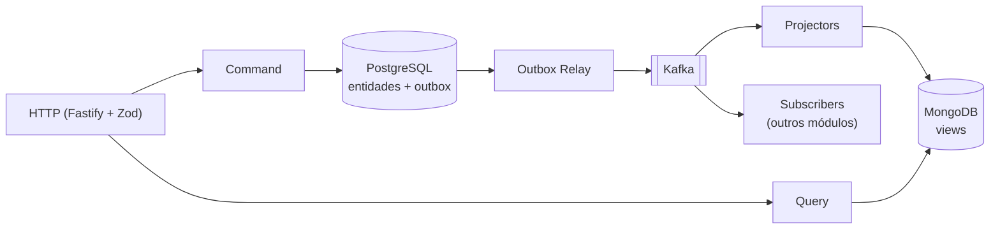

# SaaS Architecture Blueprint — NestJS Modular Clean Architecture & DDD

> **Propósito:** guia arquitetural do **Boilerplate SaaS Enterprise em NestJS**, para uso tanto por desenvolvedores quanto por agentes de IA, seguindo **DDD**, **Clean Architecture**, **Hexagonal (Ports & Adapters)** e **SOLID**, com foco em **DX**, **resiliência** e **escalabilidade**.
>
> Este arquivo é o **índice**. O conteúdo foi dividido por tema em [`docs/architecture/`](./docs/architecture/) para que humanos e agentes carreguem só o que precisam. A versão original monolítica está no histórico do git (commit inicial).

> [!IMPORTANT]
> **Hierarquia de verdade:** ADR Aceito ([docs/decisions](./docs/decisions/README.md)) > spec do módulo > `docs/architecture/*`. Vários pontos do blueprint ainda estão em decisão; veja o índice de ADRs.

## Em uma frase

Módulos de negócio isolados (`src/modules/<ctx>`), com domínio puro, que **escrevem** no PostgreSQL (Prisma + UnitOfWork + Outbox), **publicam** Integration Events via Kafka e **leem** de Read Models desnormalizados no MongoDB, mantidos por Projectors idempotentes.

## Conteúdo por tema

| # | Tema | Arquivo |
|---|---|---|
| 1 | Princípios inegociáveis | [00-principles.md](./docs/architecture/00-principles.md) |
| 2 | Tech stack | [01-tech-stack.md](./docs/architecture/01-tech-stack.md) |
| 3 | Estrutura de diretórios | [02-directory-structure.md](./docs/architecture/02-directory-structure.md) |
| 4 | Anatomia de um módulo + regras de dependência | [03-module-anatomy.md](./docs/architecture/03-module-anatomy.md) |
| 5 | CQRS poliglota, Outbox, Kafka, Projectors, Facades | [04-cqrs-and-events.md](./docs/architecture/04-cqrs-and-events.md) |
| 6 | Integrações externas e resiliência | [05-integrations-resilience.md](./docs/architecture/05-integrations-resilience.md) |
| 7 | Segurança, multi-tenancy e CASL | [06-security-tenancy-casl.md](./docs/architecture/06-security-tenancy-casl.md) |
| 8 | i18n e tratamento de erros | [07-i18n-and-errors.md](./docs/architecture/07-i18n-and-errors.md) |
| 9 | Documentação de API (Zod + Scalar) | [08-api-docs.md](./docs/architecture/08-api-docs.md) |
| 10 | Observabilidade | [09-observability.md](./docs/architecture/09-observability.md) |
| 11 | Estratégia de testes | [10-testing.md](./docs/architecture/10-testing.md) |
| 12 | Escopo funcional (módulos) | [docs/modules/](./docs/modules/): [iam](./docs/modules/iam/spec.md) · [tenancy](./docs/modules/tenancy/spec.md) · [billing](./docs/modules/billing/spec.md) · [notifications](./docs/modules/notifications/spec.md) · [audit](./docs/modules/audit/spec.md) |
| 13 | Qualidade de código e Docker | [11-code-quality.md](./docs/architecture/11-code-quality.md) |
| 14 | Ordem de implementação | [docs/roadmap/ROADMAP.md](./docs/roadmap/ROADMAP.md) |

Eventos: [docs/events/catalog.md](./docs/events/catalog.md) · Vocabulário: [docs/glossary.md](./docs/glossary.md)
