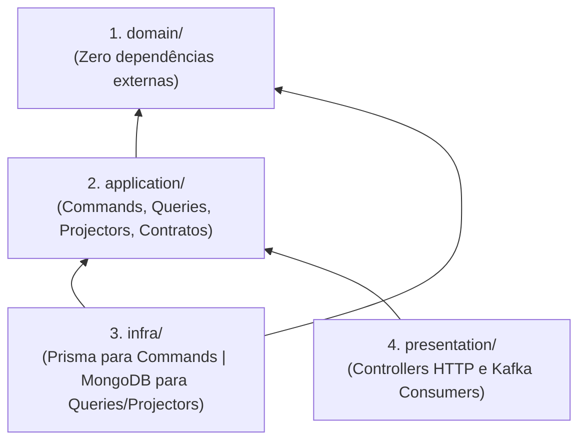

> Extraído do blueprint original. Decisões que alteram este conteúdo vivem em [docs/decisions](../decisions/README.md) — **um ADR aceito prevalece sobre este texto**.

# 4. Anatomia Interna de Cada Módulo de Negócio (`src/modules/<contexto>`)

Todo módulo dentro de `src/modules/` segue exatamente a mesma estrutura interna previsível, separando fisicamente o lado de escrita (**PostgreSQL/Prisma**) do lado de leitura (**MongoDB Views**):

```text
src/modules/billing/
├── domain/                                      # O QUE O NEGÓCIO É (100% puro, sem I/O)
│   ├── entities/                                # AggregateRoots e Entities (Subscription, Plan, Invoice)
│   ├── value-objects/                           # Imutáveis com validação (Money, BillingPeriod, CouponCode)
│   ├── events/                                  # Domain Events internos (InvoiceCreatedDomainEvent)
│   ├── factories/                               # Criação complexa (SubscriptionDomainFactory)
│   ├── services/                                # Lógica entre 2+ entidades (ProrationCalculatorDomainService)
│   └── errors/                                  # Erros de negócio (PlanQuotaExceededError, InvalidCouponError)
│
├── application/                                 # O QUE O SISTEMA FAZ (Orquestração CQRS)
│   ├── repositories/                            # Contratos de Escrita (SubscriptionsRepository) e Leitura (BillingReadRepository)
│   ├── read-models/                             # Tipagens dos Documentos/Views de Leitura (BillingOverviewReadModel)
│   ├── facades/                                 # Implementação do BillingFacadeContract
│   ├── use-cases/
│   │   ├── commands/                            # Escrita no PostgreSQL (create-subscription, cancel-subscription)
│   │   └── queries/                             # Leitura no MongoDB (get-billing-overview.query.ts)
│   ├── projectors/                              # Sincronizadores Kafka -> MongoDB (billing-overview.projector.ts)
│   ├── subscribers/                             # Handlers de Domain Events e Integration Events de negócio
│   └── policies/                                # Definições CASL específicas do módulo (BillingAbility)
│
├── infra/                                       # DETALHES TÉCNICOS DO MÓDULO
│   └── persistence/
│       ├── prisma/                              # WRITE SIDE (PostgreSQL)
│       │   ├── repositories/                    # PrismaSubscriptionsRepository
│       │   └── mappers/                         # PrismaSubscriptionMapper (toDomain / toPrisma)
│       └── mongodb/                             # READ SIDE (MongoDB Views Desnormalizadas)
│           ├── repositories/                    # MongoBillingReadRepository
│           └── schemas/                         # Índices e validação da collection (billing_overview_views)
│
├── presentation/                                # PORTA DE ENTRADA (HTTP / Webhooks / Consumers)
│   ├── http/
│   │   ├── controllers/                         # CreateSubscriptionController, GetBillingOverviewController
│   │   ├── dtos/                                # Zod Schemas + createZodDto (nestjs-zod)
│   │   └── presenters/                          # SubscriptionPresenter (toHTTP)
│   └── consumers/                               # Kafka Controllers que delegam para Subscribers e Projectors
│
└── billing.module.ts                            # Declara providers internos e exporta APENAS o BillingFacadeContract
```

## Regras de Dependência entre Camadas



