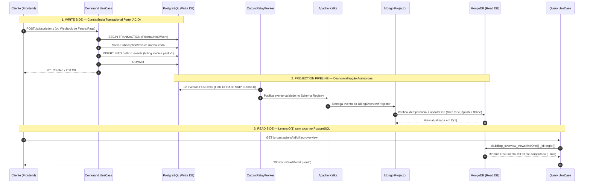
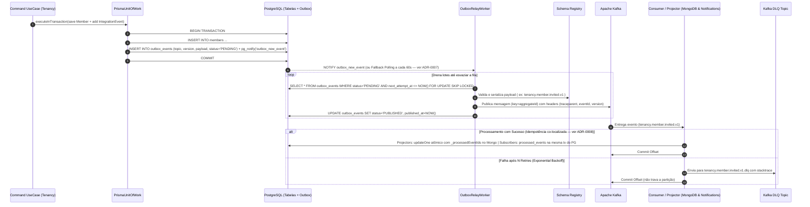

> Extraído do blueprint original. Decisões que alteram este conteúdo vivem em [docs/decisions](../decisions/README.md) — **um ADR aceito prevalece sobre este texto**.

# 5. CQRS Poliglota Real & Comunicação Orientada a Eventos

Para garantir **alta escalabilidade real** e **retirar 100% da carga de leitura do banco de dados transacional**, este boilerplate não utiliza um "CQRS apenas de pastas" batendo no mesmo banco: ele implementa **CQRS Poliglota com separação física de bancos de dados**.

## 5.1. Divisão de Responsabilidades: PostgreSQL (Write) vs. MongoDB (Read)

| Aspecto | **Command Side (`PostgreSQL 16 + Prisma`)** | **Query Side (`MongoDB 7 + Driver Nativo`)** |
| :--- | :--- | :--- |
| **Objetivo Principal** | Garantir integridade transacional (ACID), invariantes de domínio e consistência forte. | Entregar leituras (`GET`) em `~1-3ms` com zero `JOIN`, suportando filtros ricos, ordenação dinâmica e agregações. |
| **Modelagem de Dados** | **3ª Forma Normal (3NF)**: Tabelas relacionais (`organizations`, `subscriptions`, `plans`, `invoices`, `outbox_events`). | **Query-First / Documentos Desnormalizados**: Collections como `billing_overview_views` e `organization_members_views` já no formato JSON exato da UI. |
| **Fluxo de Código** | `Controller` → `Command` → `AggregateRoot` → `PrismaRepository` + `UnitOfWork` (Salva entidade + `OutboxEvent`). | `Controller` → `Query` → `MongoReadRepository` (Busca direta por `_id` ou índice composto, sem instanciar Entidades). |
| **Atualização de Dados** | Síncrona dentro da transação ACID do PostgreSQL. | Assíncrona (milissegundos depois) via **Projectors** que escutam o **Apache Kafka** e executam `$set`, `$inc`, `$push`. |

## 5.2. Fluxo Completo: Command (Postgres) → Outbox/Kafka → Projector → Query (MongoDB)



## 5.3. Exemplo Prático de Projector + Read Model no MongoDB

Em vez de executar `JOIN` entre 4 tabelas no PostgreSQL a cada abertura de dashboard, o documento na collection `billing_overview_views` do MongoDB já armazena a visão consolidada:

```typescript
// src/modules/billing/application/read-models/billing-overview.read-model.ts
export interface BillingOverviewReadModel {
  _id: string // organizationId
  organizationName: string
  plan: {
    id: string
    name: string
    priceCents: number
    currency: string
    maxMembers: number
  }
  usage: {
    currentMembers: number
    storageUsedMb: number
  }
  subscriptionStatus: 'ACTIVE' | 'TRIALING' | 'PAST_DUE' | 'CANCELED'
  currentPeriodEnd: Date
  recentInvoices: Array<{
    id: string
    amountCents: number
    status: 'PAID' | 'OPEN' | 'FAILED'
    paidAt: Date | null
  }>
  version: number
  updatedAt: Date
}
```

Os **Projectors** reagem aos eventos do Kafka de **qualquer módulo** e aplicam mutações atômicas cirúrgicas no documento do MongoDB:

```typescript
// src/modules/billing/application/projectors/billing-overview.projector.ts
@Injectable()
export class BillingOverviewProjector {
  constructor(private readonly mongo: MongoReadService) {}

  // Quando um novo membro aceita convite no módulo Tenancy (Cross-Module Projection!)
  async onMemberAccepted(event: MemberAcceptedV1Payload): Promise<void> {
    await this.mongo.collection<BillingOverviewReadModel>('billing_overview_views').updateOne(
      { _id: event.organizationId },
      {
        $inc: { 'usage.currentMembers': 1, version: 1 },
        $set: { updatedAt: new Date() },
      },
    )
  }

  // Quando uma fatura é paga no módulo Billing
  async onInvoicePaid(event: InvoicePaidV1Payload): Promise<void> {
    await this.mongo.collection<BillingOverviewReadModel>('billing_overview_views').updateOne(
      { _id: event.organizationId },
      {
        $set: { subscriptionStatus: 'ACTIVE', updatedAt: new Date() },
        $inc: { version: 1 },
        $push: {
          recentInvoices: {
            $each: [event.invoiceSummary],
            $position: 0,
            $slice: 5, // Mantém automaticamente apenas as 5 últimas faturas embutidas no documento!
          },
        },
      },
    )
  }
}
```

## 5.4. Tratamento de Consistência Eventual (`Read-Your-Own-Writes`)
Como a sincronização `PostgreSQL → Outbox → Kafka → MongoDB` leva tipicamente entre `30ms` e `150ms`, aplicamos 3 padrões para que o usuário nunca perceba atraso na interface:
1. **Retorno Enriquecido no Command**: Quando o usuário cria um recurso (`POST`), o próprio Command retorna o `id` e o resumo imediato para a UI atualizar seu estado local (*Optimistic UI*).
2. **Idempotência e Ordenação por `version` / `occurredAt`**: Todo Projector valida se o evento recebido é mais recente que a versão do documento no MongoDB antes de aplicar mudanças, evitando sobrescritas fora de ordem.
3. **Rebuild de Views (Replayability)**: Como o PostgreSQL é a fonte da verdade e o Kafka retém os eventos, qualquer View do MongoDB pode ser recriada do zero ou ter novos campos adicionados a qualquer momento sem perda de dados.

---

## 5.5. Comunicação Síncrona entre Módulos no Write Side: `Facade Pattern`
Usado durante a execução de um **Command** quando o **Módulo A** precisa validar uma regra síncrona no **Módulo B** imediatamente antes de persistir no PostgreSQL.
- **Onde fica o contrato?** Em `src/shared/contracts/facades/<modulo>.facade.contract.ts`. Isso impede referências circulares entre módulos.
- **O que a Facade retorna?** Apenas **DTOs planos (primitivos)**, nunca Entidades de Domínio.

```typescript
// src/shared/contracts/facades/billing.facade.contract.ts
export interface QuotaCheckResultDTO {
  allowed: boolean
  limit: number
  currentUsage: number
  planName: string
}

export abstract class BillingFacadeContract {
  abstract checkFeatureQuota(params: {
    organizationId: string
    featureKey: 'max_members' | 'max_storage_mb'
    currentUsage: number
  }): Promise<QuotaCheckResultDTO>
}
```

## 5.6. Arquitetura Híbrida de Eventos (Domain Events vs. Integration Events)

Utilizamos dois níveis de eventos com responsabilidades distintas:

| Tipo de Evento | Escopo | Transporte | Quando usar? |
| :--- | :--- | :--- | :--- |
| **1. Domain Event** | **Intra-módulo** (Dentro do mesmo Bounded Context) | Em memória (`DomainEvents.dispatchEventsForAggregate`) dentro da mesma transação do PostgreSQL. | Quando uma alteração em um Agregado precisa acionar uma regra imediata no **mesmo módulo** na mesma transação ACID. |
| **2. Integration Event** | **Inter-módulos**, **Projectors MongoDB** e **Sistemas Externos** | **Tabela Outbox (PostgreSQL)** → **Outbox Relay Worker** → **Apache Kafka** (com Schema Registry). | Para alimentar os **Projectors do MongoDB (CQRS Read Side)** e acionar outros módulos (`notifications`, `audit`, `billing`) de forma desacoplada e resiliente. |

### Fluxo de Resiliência do Transactional Outbox + Kafka + DLQ



### Versionamento de Eventos e Schema Registry
- Todo tópico segue a convenção: `<bounded-context>.<aggregate>.<action>.v<version>` (ex: `billing.subscription.paid.v1`).
- Mudanças quebradoras (*breaking changes*) no contrato do evento exigem a criação de uma nova versão (`v2`), mantendo o publicador emitindo `v1` e `v2` durante o período de transição.
- Todo consumidor e projector implementa **Idempotência** verificando o `eventId` (UUIDv7) antes de aplicar efeitos colaterais.

