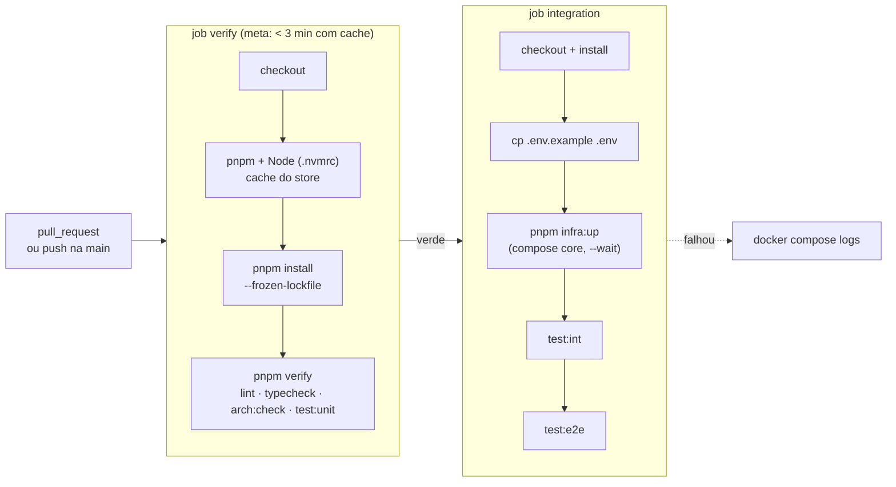

# 14. Integração Contínua (CI) e atualização de dependências

> Implementado na [T1.07](../roadmap/tasks/T1.07-ci-pipeline.md). Arquivos: [`.github/workflows/ci.yml`](../../.github/workflows/ci.yml) e [`.github/dependabot.yml`](../../.github/dependabot.yml).

O CI repete **as mesmas checagens** que o desenvolvedor (humano ou agente) roda localmente antes do PR. Ele não tem regra própria: se passa em `pnpm verify` + `test:int` + `test:e2e` na sua máquina, passa no CI, e vice-versa. É a rede de segurança que reprova violações objetivas (lint, tipos, arquitetura, testes) sem depender de revisão humana ([ADR-0002](../decisions/0002-documentacao-e-fluxo-para-ia.md), [ADR-0010](../decisions/0010-enforcement-de-arquitetura.md)).

## Fluxo



- **Gatilhos:** todo `pull_request` (qualquer branch de destino) e todo `push` na `main` (garante que a `main` pós-merge continua verde).
- **Ordem:** `integration` só roda se `verify` passar (`needs: verify`). Erros baratos (lint, tipo) falham em segundos sem pagar o custo de subir containers.
- **Cancelamento:** um novo push no mesmo PR cancela o run anterior (`concurrency` agrupado por número do PR, ou pela ref no caso de push na `main`).
- **Permissões:** o token do workflow é somente leitura (`contents: read`) e o checkout não persiste credenciais. Nenhum job usa segredos.
- **Timeouts:** `verify` 10 min, `integration` 15 min — um teste travado não consome minutos indefinidamente.

## Jobs

### `verify`

| Passo | O que faz | Equivalente local |
|---|---|---|
| `pnpm/action-setup` | Instala a versão do pnpm declarada em `packageManager` (`package.json`) | `corepack`/pnpm instalado |
| `actions/setup-node` | Node da versão em `.nvmrc` + cache do store do pnpm (chave = hash do `pnpm-lock.yaml`) | `nvm use` |
| `pnpm install --frozen-lockfile` | Falha se o `pnpm-lock.yaml` não bater com o `package.json` | `pnpm install` |
| `pnpm verify` | `lint` → `typecheck` → `arch:check` → `test:unit` (para no primeiro erro) | `pnpm verify` |

### `integration`

Sobe a infraestrutura com o **mesmo `docker-compose.yml` do ambiente local** (profile `core`: Postgres, MongoDB, Valkey), em vez de `services:` do GitHub Actions. Motivos:

- paridade com o local ([ADR-0011](../decisions/0011-infraestrutura-local.md)): mesmas imagens fixadas, mesmos healthchecks;
- o MongoDB precisa de replica set inicializado, o que o healthcheck do compose já faz e `services:` não suporta bem;
- `pnpm infra:up` usa `--wait`: os testes só começam com todos os containers *healthy*.

O `.env` é copiado do `.env.example` (valores de desenvolvimento, sem segredos). `test:int` aceita rodar sem testes (`--passWithNoTests`) até os primeiros repositórios/projectors existirem. Em caso de falha, o último passo imprime o estado (`ps --all`, que mostra loops de restart) e os logs dos containers.

## Reproduzir o CI localmente

```bash
pnpm install --frozen-lockfile
pnpm verify                       # job verify

cp .env.example .env              # se ainda não tiver .env
pnpm infra:up                     # job integration
pnpm test:int && pnpm test:e2e
pnpm infra:down
```

Os hooks do Lefthook (`pre-commit`, `pre-push`) rodam um subconjunto disso; o CI é a versão completa e obrigatória.

## Contrato protegido por teste

[`test/infra/ci-workflow.spec.ts`](../../test/infra/ci-workflow.spec.ts) (projeto `unit`, roda dentro do `pnpm verify`) falha se o workflow perder algo essencial: gatilho em `pull_request`, `concurrency` com cancelamento, token somente leitura, Node via `.nvmrc`, cache do pnpm, `--frozen-lockfile`, timeouts, `pnpm verify` no `verify`, e `infra:up` + `test:int` + `test:e2e` no `integration` depois do `verify`. Também confere o agrupamento do Dependabot.

Mudou o workflow de propósito? Atualize o teste no mesmo PR.

## Dependabot

Política definida no [ADR-0022](../decisions/0022-politica-de-atualizacao-de-dependencias.md): **PRs automáticos só para patch e minor**. Majors exigem um ADR novo e uma task própria ([ADR-0003](../decisions/0003-runtime-versoes-e-package-manager.md)).

| Ecossistema | O que atualiza | Grupos (1 PR cada) | Restrições | Prefixo do commit |
|---|---|---|---|---|
| `npm` | dependências do `package.json` (prod e dev) | `nestjs` (`@nestjs/*`, `fastify`, `@fastify/*`) · `npm` (o resto) | sem majors | `build(deps)` |
| `github-actions` | versões das actions em `.github/workflows/` | `github-actions` | — (fixadas por tag de major; o CI as valida) | `ci(deps)` |
| `docker-compose` | imagens fixadas no `docker-compose.yml` ([ADR-0021](../decisions/0021-redpanda-e-rustfs-na-infra-local.md)) | `docker-compose` | sem majors; `mongo` só patch (linha 8.0) | `build(deps)` |

- **Semanal**, com no máximo um PR por grupo, para manter o volume de review baixo.
- **NestJS e Fastify sobem juntos:** os pacotes fixam versões uns dos outros e nunca podem ficar misturados.
- **`cooldown` de 7 dias:** uma versão só é proposta depois de 7 dias publicada, reduzindo a exposição a pacotes comprometidos ou retirados logo após o release.
- Os prefixos usam o escopo `deps`, aceito pelo `commitlint.config.ts`.
- **O Dependabot nunca faz merge** (não há auto-merge). PRs dele passam pelo mesmo CI e pela revisão humana. Imagens fora do profile `core` não são exercitadas pelo CI: valide com `pnpm infra:up:full` antes do merge.
- **Majors** não viram PR: acompanhe com `pnpm outdated` e pelos changelogs, e planeje o upgrade como task + ADR.

## Como evoluir

| Preciso... | Faça |
|---|---|
| Testes que usam Kafka/Schema Registry | No passo *Start infra*, troque `pnpm infra:up` por `docker compose --profile core --profile messaging up -d --wait` e ajuste o *Dump infra logs* com os mesmos profiles |
| Um novo passo obrigatório | Adicione ao script `verify` do `package.json` (assim vale local **e** no CI) em vez de só no workflow |
| Uma nova variável de ambiente nos testes | Declare no `.env.example` (o CI copia de lá) — nunca um segredo real |
| Deploy, build de imagem, release | Fora do escopo deste workflow; crie um workflow separado com task própria |

## Configuração manual no GitHub

Feita uma vez por repositório (não fica versionada):

1. **Settings → Branches → Branch protection** da `main`: exigir os status checks `verify` e `integration` e branch atualizada antes do merge.
2. **Settings → Code security:** habilitar *Dependabot version updates* (o arquivo já existe) e, opcionalmente, *Dependabot security updates*.

## Troubleshooting

| Sintoma | Causa provável |
|---|---|
| `ERR_PNPM_OUTDATED_LOCKFILE` no install | `package.json` mudou sem `pnpm install` local; rode e commite o `pnpm-lock.yaml` |
| `verify` passa local e falha no CI | Node local diferente do `.nvmrc` (veja o aviso `Unsupported engine`) ou arquivo não commitado |
| `integration` falha em *Start infra* | Container não ficou *healthy*; veja o passo *Dump infra logs* |
| *Start infra* falha em segundos com `container ... is unhealthy` | Container em loop de restart (o `--wait` reporta crash como *unhealthy*); confira `ps --all` no *Dump infra logs*. Ex.: `mongod` 8.x em kernels 6.19 → 7.0.13 — mitigado com `GLIBC_TUNABLES=glibc.pthread.rseq=1` no `docker-compose.yml` |
| Run cancelado sozinho | Outro push no mesmo PR (comportamento esperado do `concurrency`) |
