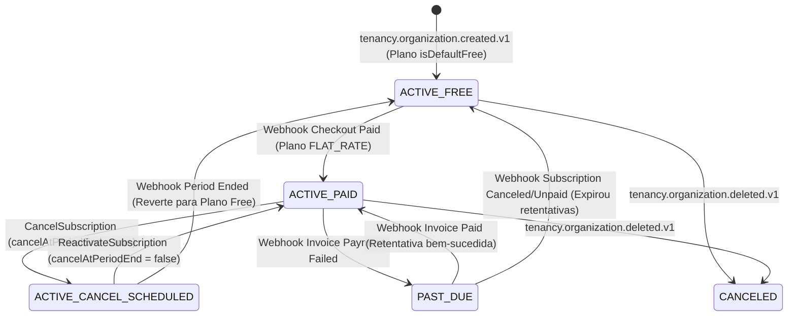

# Spec Técnica — Módulo `billing` (Plans, Subscriptions, Invoices & Quotas)

> Fonte da verdade de **engenharia e modelo de domínio** do módulo `billing`. Derivada do [PRD aprovado (`./prd.md`)](./prd.md). Arquitetura técnica: [03-module-anatomy.md](../../architecture/03-module-anatomy.md), [04-cqrs-and-events.md](../../architecture/04-cqrs-and-events.md), [05-integrations-resilience.md](../../architecture/05-integrations-resilience.md).

- **Status:** ✅ Especificado
- **PRD:** [`./prd.md`](./prd.md)
- **Fase do roadmap:** F7
- **ADRs relevantes:** [0005](../../decisions/0005-biblioteca-de-resiliencia.md), [0008](../../decisions/0008-idempotencia-de-consumers.md), [0009](../../decisions/0009-domain-events-e-unit-of-work.md), [0014](../../decisions/0014-identificadores-uuidv7.md), [0017](../../decisions/0017-isolamento-multi-tenant-rls.md), [0018](../../decisions/0018-taxonomia-eventos-billing-e-catalogo-planos.md)

---

## 1. Modelo de Domínio (`src/modules/billing/domain/`)

> Regra inegociável: `domain/` é TypeScript puro (zero imports de NestJS, Prisma, Redis, SDKs do Stripe/Asaas ou Zod).

### 1.1. Catálogo Declarativo Customizável (`src/modules/billing/domain/catalog/plans.catalog.ts`)

O catálogo é a fonte única de verdade (*Code-First*) para planos, *quotas* numéricas e *feature flags* booleanas, permitindo ao desenvolvedor que adota o boilerplate customizar sua estrutura comercial em um único arquivo:

```typescript
// Tipos inferidos automaticamente a partir do catálogo configurado pelo desenvolvedor:
export type QuotaValue = number | 'unlimited'
export type PricingModel = 'FREE' | 'FLAT_RATE' // Extensível no futuro para 'PER_SEAT' | 'USAGE_BASED'
export type BillingInterval = 'MONTHLY' | 'YEARLY'
export type SupportedCurrency = 'BRL' | 'USD'

export interface PlanDefinition<
  TQuotas extends Record<string, QuotaValue> = DefaultPlanQuotas,
  TFeatures extends Record<string, boolean> = DefaultPlanFeatures,
> {
  code: string // ex.: 'free' | 'pro_monthly' | 'pro_yearly' | 'enterprise_monthly'
  name: string
  description: string
  isDefaultFree: boolean
  pricingModel: PricingModel
  billingInterval: BillingInterval
  prices: Record<SupportedCurrency, number> // centavos inteiros
  quotas: TQuotas
  features: TFeatures
  externalPriceIds?: Partial<Record<'stripe' | 'asaas', Partial<Record<SupportedCurrency, string>>>>
}

export interface DefaultPlanQuotas {
  max_members: QuotaValue
  rate_limit_rpm: number
}

export interface DefaultPlanFeatures {
  custom_roles: boolean
  audit_logs: boolean
  custom_domain: boolean
  priority_support: boolean
}
```

### 1.2. Aggregates, Entities, Value Objects, Factories e Domain Services

| Tipo | Nome | Identidade | Responsabilidade e Propriedades |
|---|---|---|---|
| **Aggregate Root** | `Subscription` | `UniqueEntityID` (UUIDv7) | Vínculo da organização (`organizationId` único) a um plano ativo.<br/>**Props:** `organizationId: UniqueEntityID`, `planId: UniqueEntityID`, `planCode: string`, `pricingModel: PricingModel`, `status: SubscriptionStatus`, `quantity: number` (default `1` em `FREE`/`FLAT_RATE`), `currency: SupportedCurrency`, `provider: 'stripe' \| 'asaas' \| null`, `externalCustomerId: string \| null`, `externalSubscriptionId: string \| null`, `currentPeriodStart: Date`, `currentPeriodEnd: Date \| null`, `cancelAtPeriodEnd: boolean`, `canceledAt: Date \| null`, `createdAt: Date`, `updatedAt: Date` |
| **Entity** | `Plan` | `UniqueEntityID` (UUIDv7) | Representação persistida de um item do catálogo (`plans.catalog.ts`).<br/>**Props:** `code: string`, `name: string`, `description: string`, `isDefaultFree: boolean`, `pricingModel: PricingModel`, `billingInterval: BillingInterval`, `prices: Record<SupportedCurrency, Money>`, `quotas: Record<QuotaKey, QuotaValue>`, `features: Record<FeatureKey, boolean>`, `isActive: boolean` |
| **Aggregate Root** | `Invoice` | `UniqueEntityID` (UUIDv7) | Registro financeiro de cobrança de um período da assinatura.<br/>**Props:** `organizationId: UniqueEntityID`, `subscriptionId: UniqueEntityID`, `provider: 'stripe' \| 'asaas'`, `externalInvoiceId: string`, `amount: Money`, `status: InvoiceStatus` (`'OPEN' \| 'PAID' \| 'FAILED' \| 'VOID'`), `hostedInvoiceUrl: string \| null`, `periodStart: Date`, `periodEnd: Date`, `paidAt: Date \| null`, `failedAt: Date \| null`, `failureReason: string \| null`, `createdAt: Date` |
| **Value Object** | `Money` | Valor (`{ amountCents: number, currency: SupportedCurrency }`) | Inteiro `>= 0` em centavos + moeda ISO 4217 (`BRL` \| `USD`). Métodos: `add(other)`, `subtract(other)`, `multiply(factor)`, `equals(other)`. Garante que moedas distintas nunca se misturam (`BILLING.CURRENCY_MISMATCH`). |
| **Domain Factory** | `SubscriptionDomainFactory` | — | `createInitialFreeSubscription({ organizationId, defaultFreePlan, now })`: instancia a assinatura `ACTIVE` no plano `isDefaultFree: true` sem provedor externo (`provider: null`, `quantity: 1`). |
| **Domain Service / Strategy** | `SubscriptionPricingStrategy` + `ProrationCalculatorDomainService` | — | Estratégia extensível de precificação por `pricingModel` (`FreePricingStrategy`, `FlatRatePricingStrategy`). O `ProrationCalculatorDomainService` calcula `{ unusedCredit: Money, newPlanRemainingCost: Money, netCharge: Money }` em trocas de plano `FLAT_RATE`. |

### 1.3. Máquina de Estados da Assinatura (`SubscriptionStatus`)



---

## 2. Invariantes e Catálogo Fechado de Erros

Toda violação retorna `Left<DomainError>` com `code` e `i18nKey` traduzidos em `src/shared/infra/i18n/locales/{en,pt-BR}/billing.json`.

| Invariante | Regra de Domínio / Aplicação | Código de Erro (`code`) | Chave i18n (`i18nKey`) | HTTP |
|---|---|---|---|---|
| **INV-01** | O catálogo deve conter exatamente 1 plano `isDefaultFree: true` (`pricingModel: 'FREE'`) e cada organização possui exatamente 1 `Subscription` | `BILLING.DEFAULT_FREE_PLAN_NOT_FOUND`<br/>`BILLING.SUBSCRIPTION_ALREADY_EXISTS` | `errors.billing.default_free_plan_not_found`<br/>`errors.billing.subscription_already_exists` | `500`<br/>`409 Conflict` |
| **INV-02** | `Money` nunca é negativo (`amountCents >= 0`) e nunca opera entre moedas distintas | `BILLING.INVALID_MONEY_AMOUNT`<br/>`BILLING.CURRENCY_MISMATCH` | `errors.billing.invalid_money_amount`<br/>`errors.billing.currency_mismatch` | `422`<br/>`422 Unprocessable Entity` |
| **INV-03** | Webhooks de pagamento têm assinatura criptográfica validada e cada `(provider, externalEventId)` é processado uma única vez | `BILLING.INVALID_WEBHOOK_SIGNATURE` | `errors.billing.invalid_webhook_signature` | `401 Unauthorized` |
| **INV-04** | Uso acima da quota numérica do plano ou acesso a *feature flag* desabilitada no plano é bloqueado | `BILLING.PLAN_QUOTA_EXCEEDED`<br/>`BILLING.FEATURE_NOT_AVAILABLE_IN_PLAN` | `errors.billing.plan_quota_exceeded`<br/>`errors.billing.feature_not_available_in_plan` | `403 Forbidden`<br/>`403 Forbidden` |
| **INV-05** | Não é permitido fazer downgrade para um plano cujo limite numérico (`max_members`) seja menor que o uso atual da organização | `BILLING.DOWNGRADE_EXCEEDS_TARGET_PLAN_QUOTA` | `errors.billing.downgrade_exceeds_target_plan_quota` | `422 Unprocessable Entity` |
| **INV-06** | Não é permitido iniciar checkout para o plano `Free` nem para o mesmo plano já ativo na assinatura | `BILLING.CANNOT_CHECKOUT_FREE_PLAN`<br/>`BILLING.ALREADY_ON_SELECTED_PLAN` | `errors.billing.cannot_checkout_free_plan`<br/>`errors.billing.already_on_selected_plan` | `400 Bad Request`<br/>`409 Conflict` |
| **INV-07** | Não é permitido cancelar o plano `Free`; e só é permitido reativar uma assinatura que esteja com `cancelAtPeriodEnd === true` | `BILLING.CANNOT_CANCEL_FREE_PLAN`<br/>`BILLING.SUBSCRIPTION_NOT_SCHEDULED_FOR_CANCELLATION` | `errors.billing.cannot_cancel_free_plan`<br/>`errors.billing.subscription_not_scheduled_for_cancellation` | `400 Bad Request`<br/>`400 Bad Request` |

---

## 3. Commands, Queries, Subscribers e Projectors (`src/modules/billing/application/`)

### 3.1. Commands (Write — PostgreSQL + Outbox + Redis)

| Command | Input | Permissão / Regras | Integration Event (Outbox) |
|---|---|---|---|
| `CreateCheckoutSessionCommand` | `{ organizationId, planCode, currency, provider: 'stripe' \| 'asaas', successUrl, cancelUrl, ability }` | CASL `update Subscription`; INV-06; resolve provedor na `PaymentGatewayFactory`; cria sessão para o plano `FLAT_RATE` (`quantity: 1`) e retorna `{ checkoutUrl, sessionId }` | — |
| `ChangeSubscriptionPlanCommand` | `{ organizationId, targetPlanCode, ability }` | CASL `update Subscription`; INV-05 (valida se `currentMembers <= targetPlan.quotas.max_members`), INV-06; calcula pró-rata via `ProrationCalculatorDomainService`; atualiza plano no gateway externo e na `Subscription` local; invalida cache Redis `billing:entitlements:{orgId}` | `billing.subscription.updated.v1` |
| `CancelSubscriptionCommand` | `{ organizationId, ability }` | CASL `update Subscription`; INV-07; agenda cancelamento para o fim do ciclo no gateway externo; marca `cancelAtPeriodEnd = true` | `billing.subscription.updated.v1` |
| `ReactivateSubscriptionCommand` | `{ organizationId, ability }` | CASL `update Subscription`; INV-07; remove cancelamento agendado no gateway externo; marca `cancelAtPeriodEnd = false` | `billing.subscription.updated.v1` |
| `ProcessPaymentWebhookCommand` | `{ provider: 'stripe' \| 'asaas', rawBody: Buffer, signatureHeader: string }` | `@Public()`; INV-03 (valida assinatura + tabela `payment_webhook_events`); traduz payload via ACL:<br/>• `INVOICE_PAID`: grava `Invoice` (`PAID`), ativa/renova `Subscription`, invalida Redis.<br/>• `INVOICE_PAYMENT_FAILED`: grava `Invoice` (`FAILED`), marca `Subscription` como `PAST_DUE`.<br/>• `SUBSCRIPTION_ENDED`: reverte `Subscription` para o plano `isDefaultFree: true`, invalida Redis. | • `billing.invoice.paid.v1` + `billing.subscription.updated.v1`<br/>• `billing.invoice.payment_failed.v1` + `billing.subscription.updated.v1`<br/>• `billing.subscription.updated.v1` |

### 3.2. Subscribers de Eventos Externos (`src/modules/billing/presentation/consumers/`)

| Subscriber | Evento Consumido | Efeito Idempotente (`BaseSubscriber` / `processed_events` — ADR-0008) |
|---|---|---|
| `OnOrganizationCreatedSubscriber` | `tenancy.organization.created.v1` | Cria a `Subscription` inicial no plano `isDefaultFree: true` (`SubscriptionDomainFactory`), sem chamar gateway externo, e emite `billing.subscription.updated.v1`. |
| `OnOrganizationDeletedSubscriber` | `tenancy.organization.deleted.v1` | Se a organização possuía assinatura paga ativa no Stripe/Asaas (`externalSubscriptionId !== null`), cancela imediatamente no gateway externo; marca `Subscription` local como `CANCELED` e limpa cache Redis. |

### 3.3. Queries (Read — MongoDB / PostgreSQL)

| Query | Fonte de Leitura | Permissão | Output |
|---|---|---|---|
| `ListAvailablePlansQuery` | Catálogo / PostgreSQL (`plans`) | `@Public()` | `Array<{ code, name, description, isDefaultFree, pricingModel, billingInterval, prices, quotas, features }>` |
| `GetBillingOverviewQuery` | MongoDB (`billing_overview_views`) | `PoliciesGuard` (`read Subscription` + filtro CASL Nível 2 para faturas caso o cargo tenha restrição ABAC `maxAmountCents` ou `allowedStatuses`) | `{ organizationId, organizationName, subscription: { planCode, planName, pricingModel, status, currentPeriodStart, currentPeriodEnd, cancelAtPeriodEnd }, quotas, features, usage: { currentMembers }, recentInvoices: Array<{ id, amountCents, currency, status, hostedInvoiceUrl, paidAt, createdAt }> }` |

### 3.4. Read Models / Projectors (`src/modules/billing/presentation/projectors/`)

| Projector | Collection MongoDB | Eventos Consumidos | Comportamento Idempotente (`BaseProjector` — ADR-0008) |
|---|---|---|---|
| `BillingOverviewProjector` | `billing_overview_views` | • `tenancy.organization.created.v1`<br/>• `tenancy.organization.updated.v1`<br/>• `tenancy.organization.deleted.v1`<br/>• `tenancy.member.accepted.v1`<br/>• `tenancy.member.removed.v1`<br/>• `billing.subscription.updated.v1`<br/>• `billing.invoice.paid.v1`<br/>• `billing.invoice.payment_failed.v1` | • `organization.created`: cria doc inicial com `currentMembers: 1`.<br/>• `organization.updated`: atualiza `organizationName`.<br/>• `organization.deleted`: remove o documento.<br/>• `member.accepted` / `removed`: atualiza `usage.currentMembers` via `$inc` (`+1` / `-1`).<br/>• `subscription.updated`: atualiza `subscription`, `quotas` e `features`.<br/>• `invoice.paid` / `payment_failed`: adiciona fatura no topo de `recentInvoices` (`$push` com `$each`, `$sort: { createdAt: -1 }`, `$slice: 5`). |

---

## 4. Contratos Cross-Module (`src/shared/contracts/`)

### 4.1. Facade Exposta pelo `billing` (`BillingFacadeContract`)

```typescript
export interface CheckQuotaInput {
  organizationId: string
  featureKey: QuotaKey // ex.: 'max_members' | 'rate_limit_rpm'
  currentUsage: number
}

export interface CheckQuotaOutput {
  allowed: boolean
  limit: number | null // null quando 'unlimited'
  isUnlimited: boolean
  currentUsage: number
  planCode: string
  planName: string
}

export interface CheckFeatureFlagInput {
  organizationId: string
  featureKey: FeatureKey // ex.: 'custom_roles' | 'audit_logs' | 'custom_domain'
}

export interface CheckFeatureFlagOutput {
  allowed: boolean
  planCode: string
  planName: string
}

export abstract class BillingFacadeContract {
  abstract checkFeatureQuota(input: CheckQuotaInput): Promise<CheckQuotaOutput>
  abstract hasFeatureFlag(input: CheckFeatureFlagInput): Promise<CheckFeatureFlagOutput>
  abstract getOrganizationRateLimitRpm(organizationId: string): Promise<number>
}
```

### 4.2. Contrato do Gateway de Pagamento (`src/integrations/payment/`)

```typescript
export type PaymentProvider = 'stripe' | 'asaas'

export abstract class PaymentGateway {
  abstract readonly provider: PaymentProvider

  abstract createCheckoutSession(input: {
    organizationId: string
    planCode: string
    externalPriceId: string
    currency: 'BRL' | 'USD'
    quantity: number
    successUrl: string
    cancelUrl: string
  }): Promise<{ sessionId: string; checkoutUrl: string }>

  abstract updateSubscriptionPlan(input: {
    externalSubscriptionId: string
    newExternalPriceId: string
    quantity: number
    prorationAmountCents?: number
  }): Promise<void>

  abstract cancelSubscription(input: {
    externalSubscriptionId: string
    immediately: boolean
  }): Promise<void>

  abstract reactivateSubscription(input: {
    externalSubscriptionId: string
  }): Promise<void>

  abstract verifyAndParseWebhook(input: {
    rawBody: Buffer
    signatureHeader: string
  }): Promise<NormalizedPaymentWebhookEvent>
}
```

### 4.3. Integration Events Publicados pelo `billing`

| Tópico | Quando é emitido | Payload (Resumo) | Consumidores |
|---|---|---|---|
| `billing.subscription.updated.v1` | `OnOrganizationCreatedSubscriber`, `ChangeSubscriptionPlanCommand`, `CancelSubscriptionCommand`, `ReactivateSubscriptionCommand`, `ProcessPaymentWebhookCommand` | `{ organizationId, subscriptionId, planCode, planName, pricingModel, status, cancelAtPeriodEnd, currentPeriodStart, currentPeriodEnd, quotas, features }` | `billing` (`BillingOverviewProjector`), `audit` |
| `billing.invoice.paid.v1` | `ProcessPaymentWebhookCommand` | `{ organizationId, subscriptionId, invoiceId, provider, amountCents, currency, hostedInvoiceUrl, periodStart, periodEnd, paidAt }` | `billing` (`BillingOverviewProjector`), `audit` |
| `billing.invoice.payment_failed.v1` | `ProcessPaymentWebhookCommand` | `{ organizationId, subscriptionId, invoiceId, provider, amountCents, currency, hostedInvoiceUrl, reason, failedAt }` | `notifications` (alerta por e-mail + in-app para os `Owners` da organização), `billing` (`BillingOverviewProjector`), `audit` |

---

## 5. Modelagem de Dados e Armazenamento

### 5.1. PostgreSQL — Prisma Schema (`plans`, `subscriptions`, `invoices`, `payment_webhook_events`)

```prisma
model Plan {
  id              String   @id @db.Uuid
  code            String   @unique @db.VarChar(50)
  name            String   @db.VarChar(100)
  description     String   @db.VarChar(255)
  isDefaultFree   Boolean  @default(false) @map("is_default_free")
  pricingModel    String   @map("pricing_model") @db.VarChar(30) // FREE | FLAT_RATE
  billingInterval String   @map("billing_interval") @db.VarChar(20) // MONTHLY | YEARLY
  prices          Json     @db.JsonB // { BRL: number, USD: number }
  quotas          Json     @db.JsonB // Record<QuotaKey, number | 'unlimited'>
  features        Json     @db.JsonB // Record<FeatureKey, boolean>
  isActive        Boolean  @default(true) @map("is_active")
  createdAt       DateTime @map("created_at") @db.Timestamptz(3)
  updatedAt       DateTime @map("updated_at") @db.Timestamptz(3)

  subscriptions Subscription[]

  @@map("plans")
}

model Subscription {
  id                     String    @id @db.Uuid
  organizationId         String    @unique @map("organization_id") @db.Uuid
  planId                 String    @map("plan_id") @db.Uuid
  planCode               String    @map("plan_code") @db.VarChar(50)
  pricingModel           String    @map("pricing_model") @db.VarChar(30)
  status                 String    @db.VarChar(30) // ACTIVE | PAST_DUE | CANCELED
  quantity               Int       @default(1)
  currency               String    @default("BRL") @db.VarChar(3)
  provider               String?   @db.VarChar(20) // stripe | asaas | null
  externalCustomerId     String?   @map("external_customer_id") @db.VarChar(120)
  externalSubscriptionId String?   @unique @map("external_subscription_id") @db.VarChar(120)
  currentPeriodStart     DateTime  @map("current_period_start") @db.Timestamptz(3)
  currentPeriodEnd       DateTime? @map("current_period_end") @db.Timestamptz(3)
  cancelAtPeriodEnd      Boolean   @default(false) @map("cancel_at_period_end")
  canceledAt             DateTime? @map("canceled_at") @db.Timestamptz(3)
  createdAt              DateTime  @map("created_at") @db.Timestamptz(3)
  updatedAt              DateTime  @map("updated_at") @db.Timestamptz(3)

  plan     Plan      @relation(fields: [planId], references: [id])
  invoices Invoice[]

  @@map("subscriptions")
}

model Invoice {
  id                String    @id @db.Uuid
  organizationId    String    @map("organization_id") @db.Uuid
  subscriptionId    String    @map("subscription_id") @db.Uuid
  provider          String    @db.VarChar(20)
  externalInvoiceId String    @map("external_invoice_id") @db.VarChar(120)
  amountCents       Int       @map("amount_cents")
  currency          String    @db.VarChar(3)
  status            String    @db.VarChar(20) // OPEN | PAID | FAILED | VOID
  hostedInvoiceUrl  String?   @map("hosted_invoice_url")
  periodStart       DateTime  @map("period_start") @db.Timestamptz(3)
  periodEnd         DateTime  @map("period_end") @db.Timestamptz(3)
  paidAt            DateTime? @map("paid_at") @db.Timestamptz(3)
  failedAt          DateTime? @map("failed_at") @db.Timestamptz(3)
  failureReason     String?   @map("failure_reason") @db.VarChar(255)
  createdAt         DateTime  @map("created_at") @db.Timestamptz(3)

  subscription Subscription @relation(fields: [subscriptionId], references: [id], onDelete: Cascade)

  @@unique([provider, externalInvoiceId], name: "uq_invoices_provider_external_id")
  @@index([organizationId, createdAt(sort: Desc)], name: "idx_invoices_org_created")
  @@map("invoices")
}

model PaymentWebhookEvent {
  id              String   @id @db.Uuid
  provider        String   @db.VarChar(20)
  externalEventId String   @map("external_event_id") @db.VarChar(120)
  eventType       String   @map("event_type") @db.VarChar(100)
  processedAt     DateTime @map("processed_at") @db.Timestamptz(3)

  @@unique([provider, externalEventId], name: "uq_payment_webhook_provider_event")
  @@map("payment_webhook_events")
}
```

> **Políticas PostgreSQL RLS (ver [ADR-0017](../../decisions/0017-isolamento-multi-tenant-rls.md)):** As tabelas `subscriptions` e `invoices` possuem `ENABLE ROW LEVEL SECURITY` e `FORCE ROW LEVEL SECURITY` baseadas em `organization_id`.

### 5.2. Chaves no Redis (`billing`)

| Chave Redis | Valor | TTL | Propósito |
|---|---|---|---|
| `billing:entitlements:{orgId}` | `{ planCode, planName, status, quotas, features }` | `15m` | Resposta em `< 1ms` para `BillingFacade.checkFeatureQuota`, `hasFeatureFlag` e `getOrganizationRateLimitRpm` |

---

## 6. Endpoints HTTP (`src/modules/billing/presentation/http/`)

| Método | Rota | Use Case (Command / Query) | Guard / Permissão CASL | HTTP Status Sucesso |
|---|---|---|---|---|
| `GET` | `/billing/plans` | `ListAvailablePlansQuery` | `@Public()` | `200 OK` |
| `GET` | `/organizations/:orgId/billing/overview` | `GetBillingOverviewQuery` | `PoliciesGuard` (`read Subscription`) | `200 OK` |
| `POST` | `/organizations/:orgId/billing/checkout` | `CreateCheckoutSessionCommand` | `PoliciesGuard` (`update Subscription`) | `201 Created` |
| `POST` | `/organizations/:orgId/billing/subscription/change-plan` | `ChangeSubscriptionPlanCommand` | `PoliciesGuard` (`update Subscription`) | `200 OK` |
| `POST` | `/organizations/:orgId/billing/subscription/cancel` | `CancelSubscriptionCommand` | `PoliciesGuard` (`update Subscription`) | `200 OK` |
| `POST` | `/organizations/:orgId/billing/subscription/reactivate` | `ReactivateSubscriptionCommand` | `PoliciesGuard` (`update Subscription`) | `200 OK` |
| `POST` | `/webhooks/payments/:provider` | `ProcessPaymentWebhookCommand` | `@Public()` (Validação de assinatura HMAC/Token) | `200 OK` |
