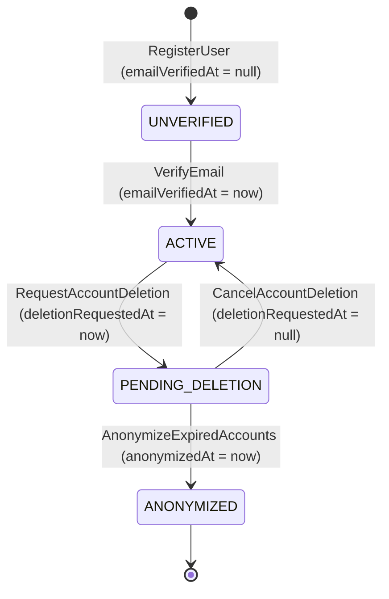

# Spec Técnica — Módulo `iam` (Identity & Access Management)

> Fonte da verdade de **engenharia e modelo de domínio** do módulo `iam`. Derivada do [PRD aprovado (`./prd.md`)](./prd.md). Arquitetura técnica: [03-module-anatomy.md](../../architecture/03-module-anatomy.md), [04-cqrs-and-events.md](../../architecture/04-cqrs-and-events.md), [06-security-tenancy-casl.md](../../architecture/06-security-tenancy-casl.md).

- **Status:** ✅ Especificado
- **PRD:** [`./prd.md`](./prd.md)
- **Fase do roadmap:** F6 (**módulo de referência**: as skills e geradores são extraídos dele na T6.08)
- **ADRs relevantes:** [0008](../../decisions/0008-idempotencia-de-consumers.md), [0009](../../decisions/0009-domain-events-e-unit-of-work.md), [0013](../../decisions/0013-estrategia-de-logging-canonical-logs-e-custo.md), [0014](../../decisions/0014-identificadores-uuidv7.md), [0015](../../decisions/0015-jwt-assimetrico-eddsa-ed25519.md)

---

## 1. Modelo de Domínio (`src/modules/iam/domain/`)

> Regra inegociável: `domain/` é TypeScript puro (zero imports de NestJS, Prisma, Redis, `jose`, `@node-rs/argon2` ou Zod).

### 1.1. Aggregates, Entities e Value Objects

| Tipo | Nome | Identidade | Responsabilidade e Propriedades |
|---|---|---|---|
| **Aggregate Root** | `User` | `UniqueEntityID` (UUIDv7) | Conta de identidade da pessoa na plataforma.<br/>**Props:** `name: UserName`, `email: Email`, `passwordHash: string \| null`, `avatarKey: string \| null`, `locale: SupportedLocale` (`'en' \| 'pt-BR'`), `emailVerifiedAt: Date \| null`, `mfaTotpSecretEncrypted: string \| null`, `mfaTotpEnabledAt: Date \| null`, `deletionRequestedAt: Date \| null`, `deletionScheduledFor: Date \| null`, `anonymizedAt: Date \| null`, `createdAt: Date`, `updatedAt: Date` |
| **Aggregate Root** | `Session` | `UniqueEntityID` (UUIDv7) | Sessão autenticada de um dispositivo, dona de uma família de refresh tokens.<br/>**Props:** `userId: UniqueEntityID`, `currentRefreshTokenHash: string`, `previousRefreshTokenHashes: string[]`, `mfaVerified: boolean`, `ipAddress: string`, `userAgent: string`, `lastActiveAt: Date`, `expiresAt: Date`, `revokedAt: Date \| null`, `revokeReason: SessionRevokeReason \| null`, `createdAt: Date` |
| **Value Object** | `Email` | Valor (`value: string`) | Normaliza (`trim().toLowerCase()`), valida formato RFC 5322 simplificado e tamanho ≤ 254 chars. Suporta também o formato reservado de anonimização (`deleted+<uuid>@deleted.invalid`). |
| **Value Object** | `UserName` | Valor (`value: string`) | Faz `trim()`, valida tamanho entre 2 e 120 caracteres. |
| **Value Object** | `Password` | Valor (`plainText: string`) | Valida a política NIST SP 800-63B pragmática sobre a senha em texto puro antes do hash (8 a 128 caracteres, ≥ 1 letra Unicode `\p{L}`, ≥ 1 dígito `\p{N}`, preservando espaços). Nunca é persistido; gera hash via `PasswordHasherGateway`. |
| **Value Object** | `SupportedLocale` | Valor (`'en' \| 'pt-BR'`) | Idioma preferido do usuário para comunicações transacionais e UI. |

### 1.2. Máquina de Estados da Conta (`User.status` derivado)

O estado operacional do `User` é derivado de seus carimbos de tempo para evitar colunas redundantes inconsistentes:



| Estado Derivado | Condição | Pode fazer Login? | Pode receber Reset de Senha? |
|---|---|---|---|
| `UNVERIFIED` | `emailVerifiedAt === null && anonymizedAt === null` | ❌ (`IAM.EMAIL_NOT_VERIFIED`) | ✅ |
| `ACTIVE` | `emailVerifiedAt !== null && deletionRequestedAt === null && anonymizedAt === null` | ✅ | ✅ |
| `PENDING_DELETION` | `deletionRequestedAt !== null && anonymizedAt === null` | ⚠️ Gera `reactivationToken` após validar 1FA (+ MFA) | ✅ |
| `ANONYMIZED` | `anonymizedAt !== null` | ❌ (`IAM.INVALID_CREDENTIALS`) | ❌ (ignorado silenciosamente) |

### 1.3. Motivos de Revogação de Sessão (`SessionRevokeReason`)
`'USER_LOGOUT' | 'REVOKED_BY_USER' | 'TOKEN_REUSE_DETECTED' | 'PASSWORD_RESET' | 'PASSWORD_CHANGED' | 'MFA_ENABLED' | 'ACCOUNT_DELETION_REQUESTED'`

---

## 2. Invariantes e Catálogo Fechado de Erros

Toda violação retorna `Left<DomainError>` com `code` e `i18nKey` traduzidos em `src/shared/infra/i18n/locales/{en,pt-BR}/iam.json`.

| Invariante | Regra de Domínio / Aplicação | Código de Erro (`code`) | Chave i18n (`i18nKey`) | HTTP |
|---|---|---|---|---|
| **INV-01** | E-mail normalizado deve ser único entre contas não anonimizadas | `IAM.EMAIL_ALREADY_IN_USE` | `errors.iam.email_already_in_use` | `409 Conflict` |
| **INV-02** | Senha deve ter 8–128 chars, ≥ 1 letra (`\p{L}`) e ≥ 1 número (`\p{N}`) | `IAM.WEAK_PASSWORD` | `errors.iam.weak_password` | `422 Unprocessable Entity` |
| **INV-03** | Login exige credenciais válidas e conta não anonimizada (com *dummy verify* se e-mail não existir) | `IAM.INVALID_CREDENTIALS` | `errors.iam.invalid_credentials` | `401 Unauthorized` |
| **INV-04** | Login exige `emailVerifiedAt !== null` (avaliado somente após a senha estar correta) | `IAM.EMAIL_NOT_VERIFIED` | `errors.iam.email_not_verified` | `403 Forbidden` |
| **INV-05** | Token de verificação de e-mail deve existir, não estar expirado (24h) e pertencer a conta `UNVERIFIED` | `IAM.INVALID_OR_EXPIRED_VERIFICATION_TOKEN` | `errors.iam.invalid_or_expired_verification_token` | `400 Bad Request` |
| **INV-06** | Apresentar um `refreshToken` que já pertence a `previousRefreshTokenHashes` revoga toda a `Session` imediatamente | `IAM.REFRESH_TOKEN_REUSED` | `errors.iam.refresh_token_reused` | `401 Unauthorized` |
| **INV-07** | Sessão utilizada no refresh ou guard deve existir, ter `revokedAt === null` e `expiresAt > now()` | `IAM.SESSION_EXPIRED_OR_REVOKED` | `errors.iam.session_expired_or_revoked` | `401 Unauthorized` |
| **INV-08** | Token de reset de senha deve existir e não estar expirado (30 min) | `IAM.INVALID_OR_EXPIRED_RESET_TOKEN` | `errors.iam.invalid_or_expired_reset_token` | `400 Bad Request` |
| **INV-09** | Na troca de senha autenticada, `currentPassword` deve conferir e `newPassword !== currentPassword` | `IAM.INVALID_CURRENT_PASSWORD`<br/>`IAM.PASSWORD_MUST_BE_DIFFERENT` | `errors.iam.invalid_current_password`<br/>`errors.iam.password_must_be_different` | `401 Unauthorized`<br/>`422 Unprocessable Entity` |
| **INV-10** | Código MFA (TOTP ou E-mail OTP) deve ser válido e *time-step* TOTP não pode ter sido usado nos últimos 90s | `IAM.INVALID_MFA_CODE` | `errors.iam.invalid_mfa_code` | `401 Unauthorized` |
| **INV-11** | `mfaChallengeToken` deve existir (TTL 5 min) e ter `< 5` falhas acumuladas | `IAM.INVALID_OR_EXPIRED_MFA_CHALLENGE`<br/>`IAM.MFA_CHALLENGE_LOCKED` | `errors.iam.invalid_or_expired_mfa_challenge`<br/>`errors.iam.mfa_challenge_locked` | `401 Unauthorized`<br/>`429 Too Many Requests` |
| **INV-12** | Ativar MFA exige que ainda não esteja ativo; desativar exige que esteja ativo | `IAM.MFA_ALREADY_ENABLED`<br/>`IAM.MFA_NOT_ENABLED` | `errors.iam.mfa_already_enabled`<br/>`errors.iam.mfa_not_enabled` | `409 Conflict`<br/>`400 Bad Request` |
| **INV-13** | Avatar deve ser `image/jpeg`, `image/png` ou `image/webp` e `<= 5_242_880` bytes; `avatarKey` deve iniciar com `avatars/{userId}/` e existir no bucket | `IAM.UNSUPPORTED_AVATAR_MIME_TYPE`<br/>`IAM.AVATAR_FILE_TOO_LARGE`<br/>`IAM.INVALID_AVATAR_KEY` | `errors.iam.unsupported_avatar_mime_type`<br/>`errors.iam.avatar_file_too_large`<br/>`errors.iam.invalid_avatar_key` | `422 Unprocessable Entity`<br/>`422 Unprocessable Entity`<br/>`400 Bad Request` |
| **INV-14** | Usuário não pode solicitar exclusão de conta enquanto for o único `Owner` de qualquer organização ativa (`TenancyFacade`) | `IAM.CANNOT_DELETE_SOLE_ORGANIZATION_OWNER` | `errors.iam.cannot_delete_sole_organization_owner` | `409 Conflict` |
| **INV-15** | Cancelamento de exclusão exige `reactivationToken` válido (TTL 5 min) e conta em `PENDING_DELETION` | `IAM.INVALID_OR_EXPIRED_REACTIVATION_TOKEN` | `errors.iam.invalid_or_expired_reactivation_token` | `400 Bad Request` |

---

## 3. Commands, Queries e Projectors (`src/modules/iam/application/`)

### 3.1. Commands (Write — PostgreSQL + Outbox + Redis)

| Command | Input (DTO / UseCase) | Regras e Efeitos | Integration Event (Outbox) |
|---|---|---|---|
| `RegisterUserCommand` | `{ name, email, password, locale? }` | INV-01, INV-02; hash Argon2id; cria `User` (`emailVerifiedAt: null`); gera token de verificação (24h, hash SHA-256 no Redis) | `iam.user.registered.v1`<br/>`iam.email_verification.requested.v1` |
| `VerifyEmailCommand` | `{ token }` | INV-05; consome token no Redis; define `user.verifyEmail(now)` | `iam.user.email_verified.v1` |
| `ResendVerificationEmailCommand` | `{ email }` | Resposta neutra se não existir ou já verificado; respeita cooldown de 60s no Redis; rota novo token (24h) | `iam.email_verification.requested.v1` *(se elegível)* |
| `AuthenticateWithPasswordCommand` | `{ email, password, ipAddress, userAgent }` | INV-03 (*dummy verify* se não existir), INV-04; se `mfaTotpEnabledAt !== null` → retorna `{ status: 'MFA_REQUIRED', mfaChallengeToken }`; se `deletionRequestedAt !== null` → retorna `{ status: 'ACCOUNT_PENDING_DELETION', deletionScheduledFor, reactivationToken }`; senão cria `Session` (`mfaVerified: false`) e retorna `{ status: 'AUTHENTICATED', accessToken, refreshToken, expiresIn }` | `iam.session.authenticated.v1` *(quando autenticado)* |
| `SendMfaEmailOtpCommand` | `{ mfaChallengeToken }` (ou `{ userId }` autenticado) | INV-11; cooldown de 60s; gera OTP numérico de 6 dígitos (hash SHA-256 no Redis, TTL 5 min) | `iam.mfa.email_otp_requested.v1` |
| `VerifyMfaChallengeCommand` | `{ mfaChallengeToken, method: 'totp' \| 'email_otp', code, ipAddress, userAgent }` | INV-10, INV-11 (máx 5 tentativas, anti-replay TOTP 90s); se conta em `PENDING_DELETION` → retorna `{ status: 'ACCOUNT_PENDING_DELETION', deletionScheduledFor, reactivationToken }`; senão cria `Session` (`mfaVerified: true`) e retorna `{ status: 'AUTHENTICATED', accessToken, refreshToken, expiresIn }` | `iam.session.authenticated.v1` *(quando autenticado)* |
| `RefreshSessionTokenCommand` | `{ refreshToken, ipAddress, userAgent }` | INV-06 (se o hash estiver em `previousRefreshTokenHashes`, revoga a `Session` e emite `iam.session.revoked.v1`), INV-07; rotaciona o hash na `Session` e emite novo par `{ accessToken, refreshToken, expiresIn }` | `iam.session.revoked.v1` *(apenas em caso de reuso detectado)* |
| `RevokeSessionCommand` | `{ userId, targetSessionId }` | Garante que `session.userId === userId`; marca `revokedAt = now()` | `iam.session.revoked.v1` |
| `RevokeOtherSessionsCommand` | `{ userId, currentSessionId }` | Revoga todas as sessões ativas do `userId` exceto `currentSessionId` | `iam.session.revoked.v1` |
| `SetupMfaTotpCommand` | `{ userId }` | INV-12; gera segredo TOTP Base32 de 20 bytes, guarda temporariamente criptografado no Redis (TTL 10 min) e retorna `{ secret, otpauthUri }` | — |
| `EnableMfaTotpCommand` | `{ userId, currentSessionId, currentPassword, totpCode }` | INV-09, INV-10, INV-12; persiste `mfaTotpSecretEncrypted` (AES-256-GCM) e `mfaTotpEnabledAt = now()`; promove `currentSessionId` para `mfaVerified = true`; revoga demais sessões | `iam.mfa.enabled.v1` |
| `DisableMfaCommand` | `{ userId, currentPassword, method: 'totp' \| 'email_otp', code }` | INV-09, INV-10, INV-12; limpa `mfaTotpSecretEncrypted` e `mfaTotpEnabledAt` | `iam.mfa.disabled.v1` |
| `RequestPasswordResetCommand` | `{ email }` | Resposta neutra se não existir ou `ANONYMIZED`; gera token de 32 bytes (hash SHA-256 no Redis, TTL 30 min, invalidando anterior) | `iam.password.reset_requested.v1` *(se elegível)* |
| `ResetPasswordCommand` | `{ token, newPassword }` | INV-02, INV-08; atualiza `passwordHash`; consome token; revoga **todas** as sessões ativas do usuário (`PASSWORD_RESET`) | `iam.password.changed.v1` |
| `ChangePasswordCommand` | `{ userId, currentSessionId, currentPassword, newPassword }` | INV-02, INV-09; atualiza `passwordHash`; revoga todas as **outras** sessões exceto `currentSessionId` (`PASSWORD_CHANGED`) | `iam.password.changed.v1` |
| `RequestAvatarUploadUrlCommand` | `{ userId, fileName, mimeType, fileSizeBytes }` | INV-13; gera key `avatars/{userId}/{uuidv7}.{ext}` e retorna `{ uploadUrl, avatarKey, expiresInSeconds: 300 }` via `StorageGateway` | — |
| `UpdateUserProfileCommand` | `{ userId, name?, locale?, avatarKey? }` | INV-13 (valida posse e existência da `avatarKey` no S3/MinIO; apaga avatar anterior se substituído); atualiza `User` | `iam.user.updated.v1` |
| `RequestAccountDeletionCommand` | `{ userId, currentPassword, mfaMethod?, mfaCode? }` | INV-09, INV-10 (se MFA ativo), INV-14 (consulta `TenancyFacade.getOrganizationsWhereUserIsSoleOwner(userId)`); define `deletionRequestedAt = now()` e `deletionScheduledFor = now() + 15d`; revoga **todas** as sessões | `iam.user.deletion_requested.v1` |
| `CancelAccountDeletionCommand` | `{ reactivationToken, ipAddress, userAgent }` | INV-15; consome `reactivationToken`; limpa `deletionRequestedAt` e `deletionScheduledFor`; cria `Session` já autenticada e retorna `{ status: 'AUTHENTICATED', accessToken, refreshToken, expiresIn }` | `iam.user.deletion_canceled.v1`<br/>`iam.session.authenticated.v1` |
| `AnonymizeExpiredAccountsCommand` | `{ now?: Date, batchSize?: number }` *(Worker/Cron)* | Busca contas com `deletionScheduledFor <= now && anonymizedAt === null`; apaga avatar no S3/MinIO; faz scrubbing irreversível de PII (`Deleted User`, `deleted+<id>@deleted.invalid`, limpa hashes/segredos, `anonymizedAt = now()`); remove sessões | `iam.user.anonymized.v1` *(1 por usuário anonimizado)* |

### 3.2. Queries (Read — MongoDB / PostgreSQL)

| Query | Fonte de Leitura | Input | Output |
|---|---|---|---|
| `GetUserProfileQuery` | MongoDB (`user_profile_views`) | `{ userId }` | `{ id, name, email, avatarUrl, locale, emailVerified, mfaEnabled, createdAt, updatedAt }` |
| `ListMyActiveSessionsQuery` | PostgreSQL (`sessions`) *(leitura direta de estado de segurança do próprio usuário)* | `{ userId, currentSessionId }` | `Array<{ id, ipAddress, userAgent, mfaVerified, lastActiveAt, createdAt, expiresAt, isCurrent }>` |

### 3.3. Read Models / Projectors (`src/modules/iam/presentation/projectors/`)

| Projector | Collection MongoDB | Eventos Consumidos | Comportamento Idempotente (`BaseProjector` — ADR-0008) |
|---|---|---|---|
| `UserProfileProjector` | `user_profile_views` | • `iam.user.registered.v1`<br/>• `iam.user.email_verified.v1`<br/>• `iam.user.updated.v1`<br/>• `iam.mfa.enabled.v1`<br/>• `iam.mfa.disabled.v1`<br/>• `iam.user.anonymized.v1` | • `registered`: insere view inicial (`emailVerified: false`, `mfaEnabled: false`).<br/>• `email_verified`: atualiza `emailVerified: true`.<br/>• `updated`: atualiza `name`, `locale`, `avatarUrl`.<br/>• `mfa.enabled` / `disabled`: atualiza `mfaEnabled`.<br/>• `anonymized`: remove o documento (`deleteOne({ _id: userId })`). |

---

## 4. Contratos Cross-Module (`src/shared/contracts/`)

### 4.1. Facade Exposta pelo `iam` (`IamFacadeContract`)

```typescript
export interface UserSummaryDto {
  id: string
  name: string
  email: string
  avatarUrl: string | null
  locale: 'en' | 'pt-BR'
  isAnonymized: boolean
}

export abstract class IamFacadeContract {
  abstract getUserSummaryById(userId: string): Promise<UserSummaryDto | null>
  abstract getUsersSummaryByIds(userIds: string[]): Promise<UserSummaryDto[]>
  abstract getUserByEmail(email: string): Promise<UserSummaryDto | null>
}
```

### 4.2. Facade Consumida pelo `iam` (`TenancyFacadeContract`)

Para validar a **INV-14** sem acoplamento entre módulos, o `RequestAccountDeletionCommand` injeta `TenancyFacadeContract`:
- `getOrganizationsWhereUserIsSoleOwner(userId: string): Promise<Array<{ id: string; name: string; slug: string }>>`

### 4.3. Integration Events Publicados pelo `iam`

| Tópico | Quando é emitido | Payload (Resumo) | Consumidores |
|---|---|---|---|
| `iam.user.registered.v1` | `RegisterUserCommand` | `{ userId, name, email, locale }` | `iam` (`UserProfileProjector`), `audit` |
| `iam.email_verification.requested.v1` | `RegisterUserCommand`, `ResendVerificationEmailCommand` | `{ userId, name, email, locale, verificationToken, expiresAt }` | `notifications` (e-mail de verificação) |
| `iam.user.email_verified.v1` | `VerifyEmailCommand` | `{ userId, email, verifiedAt }` | `iam` (`UserProfileProjector`), `audit` |
| `iam.session.authenticated.v1` | `AuthenticateWithPasswordCommand`, `VerifyMfaChallengeCommand`, `CancelAccountDeletionCommand` | `{ userId, sessionId, mfaVerified, ipAddress, userAgent }` | `audit` |
| `iam.session.revoked.v1` | `RefreshSessionTokenCommand` (reuso), `RevokeSessionCommand`, `RevokeOtherSessionsCommand` | `{ userId, sessionId, reason }` | `audit`, `notifications` *(alerta se `reason === 'TOKEN_REUSE_DETECTED'`)* |
| `iam.mfa.email_otp_requested.v1` | `SendMfaEmailOtpCommand` | `{ userId, name, email, locale, otpCode, expiresAt }` | `notifications` (e-mail com código de 6 dígitos) |
| `iam.mfa.enabled.v1` | `EnableMfaTotpCommand` | `{ userId, method: 'totp', enabledAt }` | `iam` (`UserProfileProjector`), `notifications` (alerta de segurança), `audit` |
| `iam.mfa.disabled.v1` | `DisableMfaCommand` | `{ userId, disabledAt }` | `iam` (`UserProfileProjector`), `notifications` (alerta de segurança), `audit` |
| `iam.password.reset_requested.v1` | `RequestPasswordResetCommand` | `{ userId, name, email, locale, resetToken, expiresAt }` | `notifications` (e-mail de reset), `audit` *(sem persistir `resetToken`)* |
| `iam.password.changed.v1` | `ResetPasswordCommand`, `ChangePasswordCommand` | `{ userId, changeType: 'RESET' \| 'AUTHENTICATED_CHANGE' }` | `notifications` (alerta de senha alterada), `audit` |
| `iam.user.updated.v1` | `UpdateUserProfileCommand` | `{ userId, name, avatarUrl, locale }` | `iam` (`UserProfileProjector`), `tenancy` (`OrganizationMembersProjector`), `audit` |
| `iam.user.deletion_requested.v1` | `RequestAccountDeletionCommand` | `{ userId, name, email, locale, deletionScheduledFor }` | `notifications` (e-mail de agendamento de exclusão), `audit` |
| `iam.user.deletion_canceled.v1` | `CancelAccountDeletionCommand` | `{ userId, name, email, locale, canceledAt }` | `notifications` (e-mail confirmando restauração), `audit` |
| `iam.user.anonymized.v1` | `AnonymizeExpiredAccountsCommand` | `{ userId, anonymizedAt }` | `iam` (`UserProfileProjector`), `tenancy` (remove memberships), `notifications` (limpa inbox/prefs), `audit` |

---

## 5. Modelagem de Dados e Armazenamento

### 5.1. PostgreSQL — Prisma Schema (`users` e `sessions`)

```prisma
model User {
  id                     String    @id @db.Uuid
  name                   String    @db.VarChar(120)
  email                  String    @unique @db.VarChar(254)
  passwordHash           String?   @map("password_hash")
  avatarKey              String?   @map("avatar_key") @db.VarChar(255)
  locale                 String    @default("pt-BR") @db.VarChar(10)
  emailVerifiedAt        DateTime? @map("email_verified_at") @db.Timestamptz(3)
  mfaTotpSecretEncrypted String?   @map("mfa_totp_secret_encrypted")
  mfaTotpEnabledAt       DateTime? @map("mfa_totp_enabled_at") @db.Timestamptz(3)
  deletionRequestedAt    DateTime? @map("deletion_requested_at") @db.Timestamptz(3)
  deletionScheduledFor   DateTime? @map("deletion_scheduled_for") @db.Timestamptz(3)
  anonymizedAt           DateTime? @map("anonymized_at") @db.Timestamptz(3)
  createdAt              DateTime  @map("created_at") @db.Timestamptz(3)
  updatedAt              DateTime  @map("updated_at") @db.Timestamptz(3)

  sessions Session[]

  @@index([deletionScheduledFor], name: "idx_users_deletion_scheduled_for")
  @@map("users")
}

model Session {
  id                         String    @id @db.Uuid
  userId                     String    @map("user_id") @db.Uuid
  currentRefreshTokenHash    String    @unique @map("current_refresh_token_hash") @db.VarChar(64)
  previousRefreshTokenHashes String[]  @default([]) @map("previous_refresh_token_hashes")
  mfaVerified                Boolean   @default(false) @map("mfa_verified")
  ipAddress                  String    @map("ip_address") @db.VarChar(45)
  userAgent                  String    @map("user_agent") @db.VarChar(512)
  lastActiveAt               DateTime  @map("last_active_at") @db.Timestamptz(3)
  expiresAt                  DateTime  @map("expires_at") @db.Timestamptz(3)
  revokedAt                  DateTime? @map("revoked_at") @db.Timestamptz(3)
  revokeReason               String?   @map("revoke_reason") @db.VarChar(50)
  createdAt                  DateTime  @map("created_at") @db.Timestamptz(3)

  user User @relation(fields: [userId], references: [id], onDelete: Cascade)

  @@index([userId, revokedAt, expiresAt], name: "idx_sessions_user_active")
  @@map("sessions")
}
```

### 5.2. Chaves Efêmeras no Redis (`iam`)

| Chave Redis | Valor | TTL | Propósito |
|---|---|---|---|
| `iam:email-verify:token:{sha256(token)}` | `userId` | `24h` | Resolução do token de verificação de e-mail |
| `iam:email-verify:user:{userId}` | `sha256(token)` | `24h` | Invalidar token anterior ao reenviar |
| `iam:email-verify:cooldown:{userId}` | `'1'` | `60s` | Cooldown de reenvio de e-mail de verificação |
| `iam:pwd-reset:token:{sha256(token)}` | `userId` | `30m` | Resolução do token de reset de senha |
| `iam:pwd-reset:user:{userId}` | `sha256(token)` | `30m` | Invalidar token anterior ao pedir novo reset |
| `iam:mfa:setup:{userId}` | `secretEncrypted` | `10m` | Segredo TOTP pendente até o usuário confirmar o 1º código |
| `iam:mfa:challenge:{challengeId}` | `{ userId, attempts, otpHash?, otpCooldownUntil? }` | `5m` | Estado do desafio MFA pós-senha (máx. 5 falhas) |
| `iam:mfa:totp-used:{userId}:{timeStep}` | `'1'` | `90s` | Anti-replay de código TOTP na mesma janela RFC 6238 |
| `iam:reactivation:{sha256(token)}` | `{ userId, mfaVerified }` | `5m` | Token de confirmação para cancelar exclusão de conta |
| `iam:session:revoked:{sessionId}` | `'1'` | `15m` | Denylist rápida (TTL igual ao do `accessToken`) para invalidar JWT imediatamente após logout/revogação |

### 5.3. MongoDB Read Model (`user_profile_views`)

```typescript
export interface UserProfileViewDocument {
  _id: string // userId (UUIDv7)
  name: string
  email: string
  avatarUrl: string | null
  locale: 'en' | 'pt-BR'
  emailVerified: boolean
  mfaEnabled: boolean
  lastProcessedEventVersion: number
  createdAt: Date
  updatedAt: Date
}
```

---

## 6. Endpoints HTTP (`src/modules/iam/presentation/http/`)

| Método | Rota | Use Case (Command / Query) | Auth Guard | Rate Limit | HTTP Status Sucesso |
|---|---|---|---|---|---|
| `POST` | `/auth/register` | `RegisterUserCommand` | `@Public()` | 5 / min / IP | `201 Created` |
| `POST` | `/auth/email/verify` | `VerifyEmailCommand` | `@Public()` | 10 / min / IP | `204 No Content` |
| `POST` | `/auth/email/resend-verification` | `ResendVerificationEmailCommand` | `@Public()` | 3 / min / IP | `202 Accepted` |
| `POST` | `/auth/login` | `AuthenticateWithPasswordCommand` | `@Public()` | 10 / min / IP | `200 OK` |
| `POST` | `/auth/mfa/email-otp/send` | `SendMfaEmailOtpCommand` | `@Public()` | 3 / min / IP | `202 Accepted` |
| `POST` | `/auth/mfa/verify` | `VerifyMfaChallengeCommand` | `@Public()` | 10 / min / IP | `200 OK` |
| `POST` | `/auth/refresh` | `RefreshSessionTokenCommand` | `@Public()` | 30 / min / IP | `200 OK` |
| `POST` | `/auth/logout` | `RevokeSessionCommand` (usa `sid` do JWT) | `JwtAuthGuard` | Padrão | `204 No Content` |
| `POST` | `/auth/password/forgot` | `RequestPasswordResetCommand` | `@Public()` | 3 / min / IP | `202 Accepted` |
| `POST` | `/auth/password/reset` | `ResetPasswordCommand` | `@Public()` | 5 / min / IP | `204 No Content` |
| `POST` | `/auth/account-deletion/cancel` | `CancelAccountDeletionCommand` | `@Public()` | 5 / min / IP | `200 OK` |
| `GET` | `/me` | `GetUserProfileQuery` | `JwtAuthGuard` | Padrão | `200 OK` |
| `PATCH` | `/me` | `UpdateUserProfileCommand` | `JwtAuthGuard` | Padrão | `200 OK` |
| `POST` | `/me/avatar/upload-url` | `RequestAvatarUploadUrlCommand` | `JwtAuthGuard` | 10 / min / user | `200 OK` |
| `POST` | `/me/password` | `ChangePasswordCommand` | `JwtAuthGuard` | 5 / min / user | `204 No Content` |
| `GET` | `/me/sessions` | `ListMyActiveSessionsQuery` | `JwtAuthGuard` | Padrão | `200 OK` |
| `DELETE` | `/me/sessions/:sessionId` | `RevokeSessionCommand` | `JwtAuthGuard` | Padrão | `204 No Content` |
| `POST` | `/me/sessions/revoke-others` | `RevokeOtherSessionsCommand` | `JwtAuthGuard` | Padrão | `204 No Content` |
| `POST` | `/me/mfa/totp/setup` | `SetupMfaTotpCommand` | `JwtAuthGuard` | 5 / min / user | `200 OK` |
| `POST` | `/me/mfa/totp/enable` | `EnableMfaTotpCommand` | `JwtAuthGuard` | 5 / min / user | `204 No Content` |
| `POST` | `/me/mfa/disable` | `DisableMfaCommand` | `JwtAuthGuard` | 5 / min / user | `204 No Content` |
| `POST` | `/me/delete` | `RequestAccountDeletionCommand` | `JwtAuthGuard` | 3 / min / user | `202 Accepted` |
