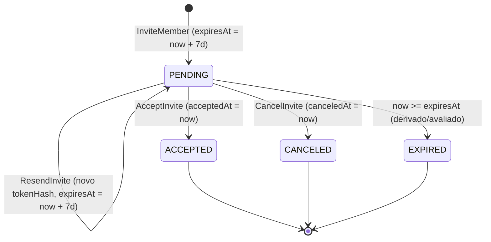

# Spec Técnica — Módulo `tenancy` (Organizations, Custom Roles & Dynamic ABAC)

> Fonte da verdade de **engenharia e modelo de domínio** do módulo `tenancy`. Derivada do [PRD aprovado (`./prd.md`)](./prd.md). Arquitetura técnica: [03-module-anatomy.md](../../architecture/03-module-anatomy.md), [04-cqrs-and-events.md](../../architecture/04-cqrs-and-events.md), [06-security-tenancy-casl.md](../../architecture/06-security-tenancy-casl.md).

- **Status:** ✅ Especificado
- **PRD:** [`./prd.md`](./prd.md)
- **Fase do roadmap:** F8
- **ADRs relevantes:** [0008](../../decisions/0008-idempotencia-de-consumers.md), [0009](../../decisions/0009-domain-events-e-unit-of-work.md), [0014](../../decisions/0014-identificadores-uuidv7.md), [0015](../../decisions/0015-jwt-assimetrico-eddsa-ed25519.md), [0016](../../decisions/0016-resolucao-tenant-ativo-por-requisicao.md), [0017](../../decisions/0017-isolamento-multi-tenant-rls.md)

---

## 1. Modelo de Domínio (`src/modules/tenancy/domain/`)

> Regra inegociável: `domain/` é TypeScript puro (zero imports de NestJS, Prisma, Redis, `@casl/ability` ou Zod). A estrutura de regras compiladas (`PermissionRule`) produz objetos JSON puros compatíveis com o contrato `RawPermissionRule` que o `TenantAbilityFactory` (`src/shared/infra/auth/casl/`) consome.

### 1.1. Aggregates, Entities, WatchedLists, Value Objects e Factories

| Tipo | Nome | Identidade | Responsabilidade e Propriedades |
|---|---|---|---|
| **Aggregate Root** | `Organization` | `UniqueEntityID` (UUIDv7) | Unidade de isolamento multi-tenant, dona da lista de membros.<br/>**Props:** `name: OrganizationName`, `slug: Slug`, `ownerRoleId: UniqueEntityID`, `defaultMemberRoleId: UniqueEntityID`, `requireMfa: boolean`, `members: OrganizationMemberList` (`WatchedList<Membership>`), `createdAt: Date`, `updatedAt: Date` |
| **Entity (interna a `Organization`)** | `Membership` | `UniqueEntityID` (UUIDv7) | Vínculo entre um `User` e uma `Organization`.<br/>**Props:** `organizationId: UniqueEntityID`, `userId: UniqueEntityID`, `roleIds: UniqueEntityID[]` (mínimo 1), `joinedAt: Date`, `updatedAt: Date` |
| **WatchedList** | `OrganizationMemberList` | — | `WatchedList<Membership>` comparada por `userId`, permitindo persistência incremental (`getNewItems()`, `getRemovedItems()`, `getUpdatedItems()`) e validação da invariante de último `Owner` em memória. |
| **Aggregate Root** | `Role` | `UniqueEntityID` (UUIDv7) | Cargo da organização (de sistema ou customizado).<br/>**Props:** `organizationId: UniqueEntityID`, `name: RoleName`, `description: string \| null`, `isSystemOwner: boolean`, `permissions: PermissionRule[]`, `createdById: UniqueEntityID \| null`, `createdAt: Date`, `updatedAt: Date` |
| **Aggregate Root** | `Invite` | `UniqueEntityID` (UUIDv7) | Convite para um e-mail ingressar na organização.<br/>**Props:** `organizationId: UniqueEntityID`, `email: string` (normalizado), `roleIds: UniqueEntityID[]`, `tokenHash: string` (SHA-256), `status: InviteStatus`, `invitedByUserId: UniqueEntityID`, `locale: 'en' \| 'pt-BR'`, `expiresAt: Date`, `acceptedAt: Date \| null`, `canceledAt: Date \| null`, `createdAt: Date`, `updatedAt: Date` |
| **Value Object** | `Slug` | Valor (`value: string`) | `trim().toLowerCase()`, regex `^[a-z0-9]+(?:-[a-z0-9]+)*$`, 3 a 60 chars, bloqueando slugs reservados (`admin`, `api`, `auth`, `me`, `billing`, `organizations`, `invites`, `health`, `docs`, `metrics`). |
| **Value Object** | `OrganizationName` | Valor (`value: string`) | `trim()`, 2 a 100 caracteres. |
| **Value Object** | `RoleName` | Valor (`value: string`) | `trim()`, 2 a 50 caracteres. |
| **Value Object** | `PermissionRule` | Valor (`RawPermissionRule`) | Compila `subject`, `actions` e atributos seguros (`onlyOwnResource`, `maxAmountCents`, `allowedStatuses`) para a representação JSONB (`{ action, subject, conditions }`). |
| **Domain Factory** | `RoleDomainFactory` | — | `createSystemOwnerRole(organizationId)` (`isSystemOwner: true`, `manage all`) e `createDefaultMemberRole(organizationId)` (`isSystemOwner: false`, leitura de `Organization`, `Member`, `Role`). |

### 1.2. Máquina de Estados do Convite (`InviteStatus`)



---

## 2. Invariantes e Catálogo Fechado de Erros

Toda violação retorna `Left<DomainError>` com `code` e `i18nKey` traduzidos em `src/shared/infra/i18n/locales/{en,pt-BR}/tenancy.json`.

| Invariante | Regra de Domínio / Aplicação | Código de Erro (`code`) | Chave i18n (`i18nKey`) | HTTP |
|---|---|---|---|---|
| **INV-01** | Cargo `isSystemOwner: true` jamais pode ser deletado, renomeado ou ter permissões reduzidas | `TENANCY.SYSTEM_ROLE_IMMUTABLE` | `errors.tenancy.system_role_immutable` | `403 Forbidden` |
| **INV-02** | Toda organização ativa deve ter sempre `>= 1` membro detentor do cargo `Owner` (`ownerRoleId`) | `TENANCY.LAST_OWNER_REQUIRED` | `errors.tenancy.last_owner_required` | `422 Unprocessable Entity` |
| **INV-03** | `Slug` deve ter formato válido, não ser palavra reservada e ser único na plataforma | `TENANCY.INVALID_SLUG`<br/>`TENANCY.SLUG_TAKEN` | `errors.tenancy.invalid_slug`<br/>`errors.tenancy.slug_taken` | `422 Unprocessable Entity`<br/>`409 Conflict` |
| **INV-04** | Soma de `membros ativos + convites pendentes não expirados + 1` não pode exceder a quota `max_members` do plano (`BillingFacade`) | `BILLING.PLAN_QUOTA_EXCEEDED` | `errors.billing.plan_quota_exceeded` | `403 Forbidden` |
| **INV-05** | Toda regra CASL hidratada força `{ organizationId }` e o acesso exige que o usuário seja membro da organização | `TENANCY.NOT_A_MEMBER_OF_ORGANIZATION`<br/>`COMMON.FORBIDDEN` | `errors.tenancy.not_a_member_of_organization`<br/>`errors.common.forbidden` | `403 Forbidden` |
| **INV-06** | Quando `organization.requireMfa === true`, o `accessToken` JWT deve conter `mfa: true`; e para ativar `requireMfa`, a sessão atual do solicitante já deve ter `mfa: true` | `TENANCY.MFA_REQUIRED_BY_ORGANIZATION`<br/>`TENANCY.CANNOT_ENABLE_MFA_POLICY_WITHOUT_MFA_SESSION` | `errors.tenancy.mfa_required_by_organization`<br/>`errors.tenancy.cannot_enable_mfa_policy_without_mfa_session` | `403 Forbidden`<br/>`422 Unprocessable Entity` |
| **INV-07** | Cargo customizado não pode ser excluído enquanto estiver atribuído a `>= 1` membro ou convite pendente, e nome de cargo deve ser único na organização | `TENANCY.ROLE_ASSIGNED_TO_MEMBERS`<br/>`TENANCY.ROLE_NAME_ALREADY_EXISTS` | `errors.tenancy.role_assigned_to_members`<br/>`errors.tenancy.role_name_already_exists` | `409 Conflict`<br/>`409 Conflict` |
| **INV-08** | Todo membro e todo convite deve ter pelo menos 1 cargo válido pertencente à própria organização | `TENANCY.MEMBER_REQUIRES_AT_LEAST_ONE_ROLE`<br/>`TENANCY.INVALID_ORGANIZATION_ROLES` | `errors.tenancy.member_requires_at_least_one_role`<br/>`errors.tenancy.invalid_organization_roles` | `422 Unprocessable Entity`<br/>`400 Bad Request` |
| **INV-09** | Não é permitido convidar um e-mail que já pertence a um membro da organização ou que já possui convite `PENDING` não expirado na mesma organização | `TENANCY.USER_ALREADY_MEMBER`<br/>`TENANCY.INVITE_ALREADY_PENDING` | `errors.tenancy.user_already_member`<br/>`errors.tenancy.invite_already_pending` | `409 Conflict`<br/>`409 Conflict` |
| **INV-10** | Aceite de convite exige convite `PENDING` não expirado e `currentUser.email === invite.email` | `TENANCY.INVALID_OR_EXPIRED_INVITE`<br/>`TENANCY.INVITE_EMAIL_MISMATCH` | `errors.tenancy.invalid_or_expired_invite`<br/>`errors.tenancy.invite_email_mismatch` | `400 Bad Request`<br/>`403 Forbidden` |
| **INV-11** | Exclusão de organização exige que o solicitante tenha o cargo `Owner` e envie `confirmationSlug === organization.slug` | `TENANCY.INVALID_CONFIRMATION_SLUG` | `errors.tenancy.invalid_confirmation_slug` | `400 Bad Request` |

---

## 3. Commands, Queries, Subscribers e Projectors (`src/modules/tenancy/application/`)

### 3.1. Commands (Write — PostgreSQL + Outbox + Redis)

| Command | Input | Permissão / Regras | Integration Event (Outbox) |
|---|---|---|---|
| `CreateOrganizationCommand` | `{ userId, name, slug }` | INV-03; cria cargos `Owner` e `Member` via `RoleDomainFactory`; cria `Organization` + `Membership` inicial do criador com `Owner` (em 1 tx `UnitOfWork`) | `tenancy.organization.created.v1`<br/>`tenancy.role.updated.v1` (x2) |
| `UpdateOrganizationCommand` | `{ organizationId, actorUserId, actorMfaVerified, ability, name?, slug?, requireMfa? }` | CASL `update Organization`; INV-03 (se mudar slug), INV-06 (se ativar `requireMfa: true`); invalida cache de permissões da org no Redis se `requireMfa` mudar | `tenancy.organization.updated.v1` |
| `DeleteOrganizationCommand` | `{ organizationId, actorUserId, confirmationSlug }` | Exige que `actorUserId` possua o cargo `Owner` (`isSystemOwner: true`) + INV-11; remove organização (CASCADE nas tabelas internas), invalida chaves `permissions:org:{orgId}:*` no Redis | `tenancy.organization.deleted.v1` |
| `CreateCustomRoleCommand` | `{ organizationId, actorUserId, ability, name, description?, permissions }` | CASL `create Role`; INV-07 (nome único na org); compila `PermissionRule[]` | `tenancy.role.updated.v1` (`change: 'created'`) |
| `UpdateRolePermissionsCommand` | `{ organizationId, roleId, ability, name?, description?, permissions? }` | CASL `update Role`; INV-01, INV-07; invalida cache Redis dos membros da org | `tenancy.role.updated.v1` (`change: 'updated'`) |
| `DeleteCustomRoleCommand` | `{ organizationId, roleId, ability }` | CASL `delete Role`; INV-01, INV-07 (bloqueia se houver membros ou convites pendentes usando o `roleId`) | `tenancy.role.updated.v1` (`change: 'deleted'`) |
| `AssignRolesToMemberCommand` | `{ organizationId, targetUserId, roleIds, ability }` | CASL `update Member`; INV-02, INV-08; invalida `permissions:org:{orgId}:user:{targetUserId}` no Redis | `tenancy.member.roles_updated.v1` |
| `TransferOwnershipCommand` | `{ organizationId, currentOwnerUserId, newOwnerUserId, fallbackRoleIdForPreviousOwner? }` | Exige que `currentOwnerUserId` tenha o cargo `Owner`; atribui `ownerRoleId` a `newOwnerUserId` e move `currentOwnerUserId` para `fallbackRoleId` (default: `defaultMemberRoleId`); invalida Redis de ambos | `tenancy.member.roles_updated.v1` (x2) |
| `RemoveMemberCommand` | `{ organizationId, targetUserId, ability }` | CASL `delete Member` (Nível 2); INV-02 (impede remover último Owner); remove `Membership` e invalida Redis | `tenancy.member.removed.v1` (`reason: 'REMOVED_BY_ADMIN'`) |
| `LeaveOrganizationCommand` | `{ organizationId, userId }` | Qualquer membro autenticado; INV-02 (impede saída se for o único Owner); remove `Membership` e invalida Redis | `tenancy.member.removed.v1` (`reason: 'LEFT_VOLUNTARILY'`) |
| `InviteMemberCommand` | `{ organizationId, invitedByUserId, ability, email, roleIds, locale? }` | CASL `create Invite`; INV-04 (`BillingFacade.checkFeatureQuota` com `activeMembers + pendingInvites`), INV-08, INV-09; gera token de 32 bytes (hash SHA-256 no Postgres, TTL 7 dias) | `tenancy.member.invited.v1` |
| `ResendInviteCommand` | `{ organizationId, inviteId, ability }` | CASL `create Invite` / `update Invite`; exige status `PENDING`; cooldown de 60s no Redis; gera novo token e estende `expiresAt = now() + 7d` | `tenancy.member.invited.v1` |
| `CancelInviteCommand` | `{ organizationId, inviteId, ability }` | CASL Nível 2 `ability.can('delete', subject('Invite', invite))` (suporta `onlyOwnResource: true` via `createdById: invitedByUserId`); marca `status = CANCELED` | `tenancy.invite.canceled.v1` |
| `AcceptInviteCommand` | `{ token, currentUserId }` | INV-10 (`IamFacade.getUserSummaryById(currentUserId)` valida `email`), INV-04 (revalida quota `max_members` em tempo de aceite); UoW: marca `Invite` como `ACCEPTED` + adiciona `Membership` na `Organization` | `tenancy.member.accepted.v1` |

### 3.2. Subscribers de Eventos Externos (`src/modules/tenancy/presentation/consumers/`)

| Subscriber | Evento Consumido | Efeito Idempotente (`BaseSubscriber` / `processed_events` — ADR-0008) |
|---|---|---|
| `OnUserAnonymizedSubscriber` | `iam.user.anonymized.v1` | Remove todos os `Membership`s restantes do `userId` anonimizado, cancela convites `PENDING` destinados a ele, invalida o Redis e emite `tenancy.member.removed.v1` (`reason: 'USER_ANONYMIZED'`) para cada organização afetada. |

### 3.3. Queries (Read — MongoDB)

| Query | Collection / Fonte | Permissão | Output |
|---|---|---|---|
| `ListMyOrganizationsQuery` | `organization_members_views` (índice por `userId`) | `JwtAuthGuard` | `Array<{ organizationId, name, slug, requireMfa, roles: Array<{ id, name, isSystemOwner }>, joinedAt }>` |
| `GetOrganizationDetailsQuery` | `organization_details_views` | `read Organization` | `{ id, name, slug, requireMfa, membersCount, pendingInvitesCount, createdAt }` |
| `FetchOrganizationMembersQuery` | `organization_members_views` + `organization_invites_views` | `read Member` | `{ members: Array<{ userId, name, email, avatarUrl, roles, joinedAt }>, pendingInvites: Array<{ inviteId, email, roles, invitedByUserId, expiresAt, createdAt }> }` |
| `FetchOrganizationRolesQuery` | `organization_roles_views` | `read Role` | `Array<{ id, name, description, isSystemOwner, permissions, membersCount, createdAt, updatedAt }>` |
| `GetInvitePreviewByTokenQuery` | PostgreSQL (`invites` + `organizations`) | `@Public()` | `{ inviteId, organizationName, organizationSlug, email, expiresAt, status }` |

### 3.4. Read Models / Projectors (`src/modules/tenancy/presentation/projectors/`)

| Projector | Collection MongoDB | Eventos Consumidos | Comportamento Idempotente (`BaseProjector` — ADR-0008) |
|---|---|---|---|
| `OrganizationMembersProjector` | `organization_members_views`<br/>`organization_invites_views`<br/>`organization_details_views` | • `tenancy.organization.created.v1`<br/>• `tenancy.organization.updated.v1`<br/>• `tenancy.organization.deleted.v1`<br/>• `tenancy.member.invited.v1`<br/>• `tenancy.invite.canceled.v1`<br/>• `tenancy.member.accepted.v1`<br/>• `tenancy.member.roles_updated.v1`<br/>• `tenancy.member.removed.v1`<br/>• `iam.user.updated.v1` | Mantém a visão desnormalizada de membros (com `name`, `email`, `avatarUrl` hidratados via `IamFacade` na entrada e sincronizados via `iam.user.updated.v1`), convites pendentes e o resumo da organização. Em `organization.deleted.v1`, remove todos os documentos daquela `organizationId`. |
| `OrganizationRolesProjector` | `organization_roles_views` | • `tenancy.role.updated.v1`<br/>• `tenancy.member.accepted.v1`<br/>• `tenancy.member.roles_updated.v1`<br/>• `tenancy.member.removed.v1`<br/>• `tenancy.organization.deleted.v1` | Mantém a lista de cargos da organização com suas regras ABAC e o contador pré-calculado `membersCount` (`$inc`). |

---

## 4. Contratos Cross-Module (`src/shared/contracts/`)

### 4.1. Facade Exposta pelo `tenancy` (`TenancyFacadeContract`)

```typescript
export interface OrganizationSummaryDto {
  id: string
  name: string
  slug: string
  requireMfa: boolean
  auditLogsEnabled: boolean
}

export interface MemberAuthorizationContextDto {
  isMember: boolean
  requireMfa: boolean
  isSystemOwner: boolean
  rawRules: RawPermissionRule[]
}

export abstract class TenancyFacadeContract {
  abstract getMemberAuthorizationContext(params: {
    userId: string
    organizationId: string
  }): Promise<MemberAuthorizationContextDto>

  abstract getOrganizationSummary(organizationId: string): Promise<OrganizationSummaryDto | null>

  abstract getOrganizationsWhereUserIsSoleOwner(
    userId: string,
  ): Promise<OrganizationSummaryDto[]>

  abstract getOrganizationOwnerUserIds(organizationId: string): Promise<string[]>
}
```
*(Nota: `getOrganizationOwnerUserIds` permite que o módulo `notifications` saiba quais usuários são `Owner` para notificá-los em `billing.invoice.payment_failed.v1`).*

### 4.2. Facades Consumidas pelo `tenancy`

- **`BillingFacadeContract.checkFeatureQuota({ organizationId, featureKey: 'max_members', currentUsage })`:** consumida em `InviteMemberCommand` e `AcceptInviteCommand`.
- **`IamFacadeContract.getUserSummaryById(userId)` / `getUserByEmail(email)`:** consumida em `InviteMemberCommand` (para verificar se o e-mail já é membro), `AcceptInviteCommand` (para validar `user.email === invite.email`) e no `OrganizationMembersProjector`.

### 4.3. Integration Events Publicados pelo `tenancy`

| Tópico | Quando é emitido | Payload (Resumo) | Consumidores |
|---|---|---|---|
| `tenancy.organization.created.v1` | `CreateOrganizationCommand` | `{ organizationId, name, slug, ownerUserId, requireMfa }` | `billing` (cria assinatura `Free` + `BillingOverviewProjector`), `tenancy` (projectors), `audit` |
| `tenancy.organization.updated.v1` | `UpdateOrganizationCommand` | `{ organizationId, name, slug, requireMfa }` | `billing` (`BillingOverviewProjector` atualiza nome), `tenancy` (projectors), `audit` |
| `tenancy.organization.deleted.v1` | `DeleteOrganizationCommand` | `{ organizationId, slug, deletedByUserId }` | `billing` (cancela assinatura e remove view), `tenancy` (limpa views), `audit` |
| `tenancy.role.updated.v1` | `CreateOrganizationCommand`, `Create/Update/DeleteCustomRoleCommand` | `{ organizationId, roleId, name, isSystemOwner, change: 'created' \| 'updated' \| 'deleted', permissions }` | `tenancy` (`OrganizationRolesProjector`), `audit` |
| `tenancy.member.roles_updated.v1` | `AssignRolesToMemberCommand`, `TransferOwnershipCommand` | `{ organizationId, userId, previousRoleIds, currentRoleIds }` | `tenancy` (projectors), `audit` |
| `tenancy.member.invited.v1` | `InviteMemberCommand`, `ResendInviteCommand` | `{ organizationId, organizationName, inviteId, email, roleIds, invitedByUserId, inviteToken, locale, expiresAt }` | `notifications` (e-mail de convite), `tenancy` (`OrganizationMembersProjector`), `audit` *(sem `inviteToken`)* |
| `tenancy.invite.canceled.v1` | `CancelInviteCommand` | `{ organizationId, inviteId, email, canceledByUserId }` | `tenancy` (`OrganizationMembersProjector`), `audit` |
| `tenancy.member.accepted.v1` | `AcceptInviteCommand` | `{ organizationId, userId, inviteId, roleIds }` | `billing` (`BillingOverviewProjector` `$inc currentMembers`), `tenancy` (projectors), `audit` |
| `tenancy.member.removed.v1` | `RemoveMemberCommand`, `LeaveOrganizationCommand`, `OnUserAnonymizedSubscriber` | `{ organizationId, userId, roleIds, reason: 'REMOVED_BY_ADMIN' \| 'LEFT_VOLUNTARILY' \| 'USER_ANONYMIZED' }` | `billing` (`BillingOverviewProjector` `$inc currentMembers: -1`), `tenancy` (projectors), `audit` |

---

## 5. Modelagem de Dados e Armazenamento

### 5.1. PostgreSQL — Prisma Schema (`organizations`, `roles`, `memberships`, `invites`) + RLS

```prisma
model Organization {
  id                  String   @id @db.Uuid
  name                String   @db.VarChar(100)
  slug                String   @unique @db.VarChar(60)
  ownerRoleId         String   @map("owner_role_id") @db.Uuid
  defaultMemberRoleId String   @map("default_member_role_id") @db.Uuid
  requireMfa          Boolean  @default(false) @map("require_mfa")
  createdAt           DateTime @map("created_at") @db.Timestamptz(3)
  updatedAt           DateTime @map("updated_at") @db.Timestamptz(3)

  roles       Role[]
  memberships Membership[]
  invites     Invite[]

  @@map("organizations")
}

model Role {
  id             String   @id @db.Uuid
  organizationId String   @map("organization_id") @db.Uuid
  name           String   @db.VarChar(50)
  description    String?  @db.VarChar(200)
  isSystemOwner  Boolean  @default(false) @map("is_system_owner")
  permissions    Json     @db.JsonB
  createdById    String?  @map("created_by_id") @db.Uuid
  createdAt      DateTime @map("created_at") @db.Timestamptz(3)
  updatedAt      DateTime @map("updated_at") @db.Timestamptz(3)

  organization Organization @relation(fields: [organizationId], references: [id], onDelete: Cascade)

  @@unique([organizationId, name], name: "uq_roles_org_name")
  @@index([organizationId], name: "idx_roles_org")
  @@map("roles")
}

model Membership {
  id             String   @id @db.Uuid
  organizationId String   @map("organization_id") @db.Uuid
  userId         String   @map("user_id") @db.Uuid
  roleIds        String[] @map("role_ids") @db.Uuid
  joinedAt       DateTime @map("joined_at") @db.Timestamptz(3)
  updatedAt      DateTime @map("updated_at") @db.Timestamptz(3)

  organization Organization @relation(fields: [organizationId], references: [id], onDelete: Cascade)

  @@unique([organizationId, userId], name: "uq_memberships_org_user")
  @@index([userId], name: "idx_memberships_user")
  @@map("memberships")
}

model Invite {
  id              String    @id @db.Uuid
  organizationId  String    @map("organization_id") @db.Uuid
  email           String    @db.VarChar(254)
  roleIds         String[]  @map("role_ids") @db.Uuid
  tokenHash       String    @unique @map("token_hash") @db.VarChar(64)
  status          String    @db.VarChar(20) // PENDING | ACCEPTED | CANCELED
  invitedByUserId String    @map("invited_by_user_id") @db.Uuid
  locale          String    @default("pt-BR") @db.VarChar(10)
  expiresAt       DateTime  @map("expires_at") @db.Timestamptz(3)
  acceptedAt      DateTime? @map("accepted_at") @db.Timestamptz(3)
  canceledAt      DateTime? @map("canceled_at") @db.Timestamptz(3)
  createdAt       DateTime  @map("created_at") @db.Timestamptz(3)
  updatedAt       DateTime  @map("updated_at") @db.Timestamptz(3)

  organization Organization @relation(fields: [organizationId], references: [id], onDelete: Cascade)

  @@index([organizationId, status], name: "idx_invites_org_status")
  @@index([organizationId, email, status], name: "idx_invites_org_email_status")
  @@map("invites")
}
```

> **Políticas PostgreSQL RLS (ver [ADR-0017](../../decisions/0017-isolamento-multi-tenant-rls.md)):** As tabelas `roles`, `memberships` e `invites` possuem `ENABLE ROW LEVEL SECURITY` e `FORCE ROW LEVEL SECURITY` restritos a `organization_id::text = current_setting('app.current_tenant_id', true)` (ou `'SYSTEM_BYPASS'`).

### 5.2. Chaves no Redis (`tenancy`)

| Chave Redis | Valor | TTL | Propósito |
|---|---|---|---|
| `permissions:org:{orgId}:user:{userId}` | `MemberAuthorizationContextDto` (JSON) | `1h` | Hidratação sub-milissegundo do `PoliciesGuard` e `TenantAbilityFactory` |
| `tenancy:invite:cooldown:{inviteId}` | `'1'` | `60s` | Cooldown de reenvio de e-mail de convite (`ResendInviteCommand`) |

---

## 6. Endpoints HTTP (`src/modules/tenancy/presentation/http/`)

| Método | Rota | Use Case (Command / Query) | Guard / Permissão CASL | HTTP Status Sucesso |
|---|---|---|---|---|
| `POST` | `/organizations` | `CreateOrganizationCommand` | `JwtAuthGuard` | `201 Created` |
| `GET` | `/me/organizations` | `ListMyOrganizationsQuery` | `JwtAuthGuard` | `200 OK` |
| `GET` | `/organizations/:orgId` | `GetOrganizationDetailsQuery` | `PoliciesGuard` (`read Organization`) | `200 OK` |
| `PATCH` | `/organizations/:orgId` | `UpdateOrganizationCommand` | `PoliciesGuard` (`update Organization`) | `200 OK` |
| `DELETE` | `/organizations/:orgId` | `DeleteOrganizationCommand` | `PoliciesGuard` (Cargo `Owner` obrigatório) | `204 No Content` |
| `GET` | `/organizations/:orgId/roles` | `FetchOrganizationRolesQuery` | `PoliciesGuard` (`read Role`) | `200 OK` |
| `POST` | `/organizations/:orgId/roles` | `CreateCustomRoleCommand` | `PoliciesGuard` (`create Role`) | `201 Created` |
| `PATCH` | `/organizations/:orgId/roles/:roleId` | `UpdateRolePermissionsCommand` | `PoliciesGuard` (`update Role`) | `200 OK` |
| `DELETE` | `/organizations/:orgId/roles/:roleId` | `DeleteCustomRoleCommand` | `PoliciesGuard` (`delete Role`) | `204 No Content` |
| `GET` | `/organizations/:orgId/members` | `FetchOrganizationMembersQuery` | `PoliciesGuard` (`read Member`) | `200 OK` |
| `PUT` | `/organizations/:orgId/members/:userId/roles` | `AssignRolesToMemberCommand` | `PoliciesGuard` (`update Member`) | `200 OK` |
| `POST` | `/organizations/:orgId/transfer-ownership` | `TransferOwnershipCommand` | `PoliciesGuard` (Cargo `Owner` obrigatório) | `200 OK` |
| `DELETE` | `/organizations/:orgId/members/:userId` | `RemoveMemberCommand` | `PoliciesGuard` (`delete Member` + CASL Nível 2) | `204 No Content` |
| `POST` | `/organizations/:orgId/leave` | `LeaveOrganizationCommand` | `PoliciesGuard` (Membro da org) | `204 No Content` |
| `POST` | `/organizations/:orgId/invites` | `InviteMemberCommand` | `PoliciesGuard` (`create Invite`) | `201 Created` |
| `POST` | `/organizations/:orgId/invites/:inviteId/resend` | `ResendInviteCommand` | `PoliciesGuard` (`create Invite`) | `202 Accepted` |
| `DELETE` | `/organizations/:orgId/invites/:inviteId` | `CancelInviteCommand` | `PoliciesGuard` (`delete Invite` + CASL Nível 2) | `204 No Content` |
| `GET` | `/invites/:token` | `GetInvitePreviewByTokenQuery` | `@Public()` | `200 OK` |
| `POST` | `/invites/:token/accept` | `AcceptInviteCommand` | `JwtAuthGuard` | `200 OK` |
