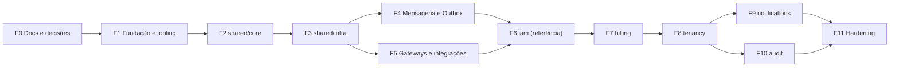

# Roadmap de Implementação

Fonte única do **que falta fazer, em que ordem e com qual status**. Substitui o §14 do blueprint original.

- Tasks com arquivo detalhado → link na coluna ID. Sem link = ainda não detalhada (é detalhada *just-in-time* ao iniciar a fase, via skill [`detail-task`](../../.agents/skills/detail-task/SKILL.md)).
- **Bloqueios:** uma task não começa enquanto um ADR listado nela estiver ⏳ Proposto, ou enquanto uma dependência não estiver ✅.
- Status: ☐ A fazer · 📝 Detalhada · 🔄 Em andamento · 👀 Em review · ✅ Concluída · ⛔ Bloqueada

---

## F0 — Documentação e decisões

**Saída da fase:** estrutura de docs criada; ADRs que bloqueiam a F1 decididos; PRDs e specs completas dos 5 módulos fechados.

| ID | Task | Depende de | ADRs | Status |
|---|---|---|---|---|
| T0.01 | Estrutura de docs, AGENTS.md, ADRs iniciais, roadmap, specs, skills de workflow | — | 0001, 0002 | ✅ |
| T0.02 | **(Humano)** Decidir ADRs iniciais (0003 a 0011 todos ✅ Aceitos) | T0.01 | 0003–0011 | ✅ |
| T0.03 | PRD (`prd.md`) + Spec (`spec.md`) completa do módulo `iam` + ADRs de IDs (0014) e JWT (0015) | T0.02 | 0014, 0015 | ✅ |
| T0.04 | PRD (`prd.md`) + Spec (`spec.md`) completa do módulo `tenancy` + ADRs de Tenant ativo (0016) e RLS (0017) | T0.03 | 0016, 0017 | ✅ |
| T0.05 | PRD (`prd.md`) + Spec (`spec.md`) completa do módulo `billing` + ADR de evento de pagamento e catálogo (0018) | T0.04 | 0018 | ✅ |
| T0.06 | PRD (`prd.md`) + Spec (`spec.md`) completa do módulo `notifications` | T0.05 | — | ✅ |
| T0.07 | PRD (`prd.md`) + Spec (`spec.md`) completa do módulo `audit` + ADRs de Envelope (0019) e Schema Registry (0020) | T0.06 | 0019, 0020 | ✅ |

## F1 — Fundação e tooling

**Saída da fase:** `pnpm verify` roda lint + typecheck + arch + testes no CI; `docker compose --profile core up` saudável; `GET /health/live` responde.

| ID | Task | Depende de | ADRs | Status |
|---|---|---|---|---|
| [T1.01](./tasks/T1.01-scaffold-nestjs-fastify.md) | Scaffold NestJS + Fastify + TS strict + pnpm + aliases + `/health/live` | T0.02 | 0003 | 📝 |
| [T1.02](./tasks/T1.02-biome-ultracite.md) | Biome + Ultracite + scripts de lint/format | T1.01 | 0003 | 📝 |
| [T1.03](./tasks/T1.03-vitest-setup.md) | Vitest + SWC: projetos unit / int / e2e + setups | T1.01 | 0003 | 📝 |
| [T1.04](./tasks/T1.04-lefthook-commitlint.md) | Lefthook (pre-commit, commit-msg, pre-push) + Conventional Commits | T1.02, T1.03 | — | 📝 |
| [T1.05](./tasks/T1.05-architecture-enforcement.md) | dependency-cruiser com as regras de camadas/módulos + `pnpm arch:check` | T1.01 | 0010 | 📝 |
| [T1.06](./tasks/T1.06-docker-compose.md) | Docker Compose com profiles e healthchecks + `.env.example` | T1.01 | 0003, 0011, 0012 | 📝 |
| [T1.07](./tasks/T1.07-ci-pipeline.md) | CI (GitHub Actions): `verify` + int/e2e com services | T1.02–T1.06 | — | 📝 |
| [T1.08](./tasks/T1.08-agents-md-refresh.md) | Atualizar comandos reais no AGENTS.md + AGENTS.md aninhados por camada | T1.07 | 0002 | 📝 |
| [T1.09](./tasks/T1.09-project-initializer.md) | Script de inicialização de novo projeto (`pnpm init:project`): renomeação, `.env` + chaves criptográficas e reset do roadmap | T1.06, T1.08 | 0012 | 📝 |

## F2 — `src/shared/core` (blocos de DDD, zero framework)

**Saída da fase:** blocos com 100% de cobertura unitária; `arch:check` garante zero import de framework.

| ID | Task | Depende de | ADRs | Status |
|---|---|---|---|---|
| T2.01 | `Either` (left/right + helpers) + `DomainError` + `common-errors` | F1 | — | ☐ |
| T2.02 | `UniqueEntityID` (UUIDv7) + `Entity` + `ValueObject` | T2.01 | 0014 | ☐ |
| T2.03 | `AggregateRoot` + `DomainEvent` + registro/dispatch de domain events | T2.02 | 0009 | ☐ |
| T2.04 | `WatchedList` | T2.02 | — | ☐ |
| T2.05 | Envelope `IntegrationEvent` versionado + convenção de tópicos + helper de definição de contrato (`defineIntegrationEventContract` Zod + tipo) | T2.03 | 0008, 0014, 0019, 0020 | ☐ |

## F3 — `src/shared/infra` (plataforma)

**Saída da fase:** app sobe com config validada, erros i18n em Problem Details, `/docs` (Scalar), Prisma + UoW + Outbox, Mongo, Redis, observabilidade, rate limit e resiliência; infra de testes isolados funcionando.

| ID | Task | Depende de | ADRs | Status |
|---|---|---|---|---|
| T3.01 | `EnvModule` (Zod), falha rápida no boot | F2 | 0012, 0013 | ☐ |
| T3.02 | Camada HTTP: Fastify, Helmet, CORS, `GlobalDomainExceptionFilter` (RFC 7807), mapeamento `Either` → HTTP | T3.01 | 0013 | ☐ |
| T3.03 | i18n (`en`, `pt-BR`) integrado ao filtro + teste que garante paridade de chaves | T3.02 | — | ☐ |
| T3.04 | Validação Zod (`nestjs-zod`) + OpenAPI + Scalar em `/docs` | T3.02 | 0003 | ☐ |
| T3.05 | `PrismaModule` + schema `OutboxEvent` + `PrismaUnitOfWork` (ALS + propagação de `app.current_tenant_id` para RLS) | T3.01 | 0007, 0009, 0017 | ☐ |
| T3.06 | `MongoReadModule` + `MongoReadService` + registro/sincronização de índices de views | T3.01 | — | ☐ |
| T3.07 | `RedisModule` + `CacheGateway` adapter + `DistributedLockService` | T3.01 | — | ☐ |
| T3.08 | Observabilidade: `nestjs-pino` (Canonical Log Lines, `LogContextPort`, redact, sampling) + OTel `instrumentation.ts` + `/metrics` + `/health/ready` | T3.05–T3.07 | 0006, 0013 | ☐ |
| T3.09 | Rate limiting distribuído (Redis) por IP / usuário / tier | T3.07 | — | ☐ |
| T3.10 | `ResilienceModule` + `ResilienceRegistry` (`cockatiel`) + `@Resilient` + métricas/logs de breaker | T3.08 | 0005, 0013 | ☐ |
| T3.11 | Infra de testes: schema PG / DB Mongo isolados por worker, limpeza do Redis, base de factories e fakes | T3.05–T3.07 | 0011 | ☐ |

## F4 — Mensageria, Outbox e BaseProjector

**Saída da fase:** teste e2e prova o pipeline Command fake → Outbox → Kafka → Projector → Mongo, com idempotência e DLQ.

| ID | Task | Depende de | ADRs | Status |
|---|---|---|---|---|
| T4.01 | Módulo Kafka: producer/consumer atrás de portas (`EventBusGateway`) | F3 | 0004 | ☐ |
| T4.02 | Schema Registry: registro/validação/serialização JSON Schema a partir dos contratos Zod (`BACKWARD`) | T4.01, T2.05 | 0004, 0020 | ☐ |
| T4.03 | `OutboxRelayWorker` (`LISTEN/NOTIFY` + fallback 60s, entrypoint de worker) + propagação de `traceparent` | T4.01, T3.05 | 0007, 0013 | ☐ |
| T4.04 | Pipeline de consumo: retry com backoff + DLQ + métricas de lag | T4.01 | 0013 | ☐ |
| T4.05 | Idempotência: `BaseProjector` (Mongo) + `BaseSubscriber` (`processed_events`) | T4.04 | 0008, 0013 | ☐ |
| T4.06 | Teste e2e do pipeline CQRS completo com um módulo `_example` descartável | T4.02–T4.05 | — | ☐ |

## F5 — Gateways compartilhados e integrações

**Saída da fase:** adapters reais + fakes para teste; autenticação/autorização base pronta.

| ID | Task | Depende de | ADRs | Status |
|---|---|---|---|---|
| T5.01 | `Argon2Hasher` + `JwtEncrypter` (`EdDSA`/`Ed25519` via `jose`) + `AesGcmCipher` (MFA) | F3 | 0015 | ☐ |
| T5.02 | `S3StorageAdapter` (MinIO) + presigned URLs + `FakeStorage` | T3.10 | 0005 | ☐ |
| T5.03 | `NodemailerAdapter` (Mailpit) + templates i18n + `FakeMail` | T3.10, T3.03 | 0005 | ☐ |
| T5.04 | Payment: contrato + factory + Stripe adapter + ACL + `FakePaymentGateway` | T3.10 | 0005 | ☐ |
| T5.05 | Asaas adapter + ACL + resolução explícita do provedor na Factory | T5.04 | 0005 | ☐ |
| T5.06 | Auth infra: JWT guard, `@CurrentUser`, `@CurrentTenant` (`:orgId` / `X-Organization-Id`), `TenantAbilityFactory`, `PoliciesGuard` | T5.01, T3.07 | 0015, 0016 | ☐ |

## F6 — Módulo `iam` (módulo de referência)

**Saída da fase:** iam completo com testes nos 3 níveis; **skills e geradores extraídos e validados**. PRD: [iam/prd.md](../modules/iam/prd.md) · Spec: [iam/spec.md](../modules/iam/spec.md).

| ID | Task | Depende de | ADRs | Status |
|---|---|---|---|---|
| T6.01 | Domínio: `User`, `Session`, `Email`, `UserName`, `Password`, `SupportedLocale`, máquina de estados e catálogo de erros + unit | F4, F5 | 0014 | ☐ |
| T6.02 | `RegisterUser` + `VerifyEmail` + `ResendVerificationEmail` ponta a ponta (Prisma + Redis + controller + e2e) | T6.01 | 0009 | ☐ |
| T6.03 | `AuthenticateWithPassword` + `RefreshSessionToken` (rotação e detecção de reuso) + gestão de sessões (`ListMyActiveSessions`, `RevokeSession`, `RevokeOtherSessions`) | T6.02 | 0015 | ☐ |
| T6.04 | MFA 2FA: `SetupMfaTotp`, `EnableMfaTotp`, `DisableMfa`, `SendMfaEmailOtp`, `VerifyMfaChallenge` (TOTP RFC 6238 anti-replay + E-mail OTP) | T6.03 | 0015 | ☐ |
| T6.05 | `RequestPasswordReset` + `ResetPassword` + `ChangePassword` (revogação seletiva de sessões) | T6.03 | — | ☐ |
| T6.06 | Perfil e Avatar em 2 passos: `RequestAvatarUploadUrl` + `UpdateUserProfile` (`StorageGateway`) | T6.02 | — | ☐ |
| T6.07 | Exclusão e Anonimização LGPD/GDPR (Grace period de 15 dias): `RequestAccountDeletion`, `CancelAccountDeletion`, `AnonymizeExpiredAccounts` | T6.03, T6.04 | — | ☐ |
| T6.08 | `UserProfileProjector` + `GetUserProfileQuery` | T6.02 | 0008 | ☐ |
| T6.09 | `IamFacade` + contrato em `shared/contracts` | T6.02 | — | ☐ |
| T6.10 | **Extrair skills + geradores** (create-module, create-command, create-query-projector, add-integration-event) e validar gerando um módulo dummy | T6.01–T6.09 | 0002 | ☐ |

## F7 — Módulo `billing`

PRD: [billing/prd.md](../modules/billing/prd.md) · Spec: [billing/spec.md](../modules/billing/spec.md). **Primeiro módulo construído com as skills**: registrar atritos e melhorar as skills.

| ID | Task | Depende de | ADRs | Status |
|---|---|---|---|---|
| T7.01 | Domínio: Catálogo declarativo `plans.catalog.ts` (`FREE` + `FLAT_RATE`), `Plan`, `Subscription`, `Invoice`, `Money`, `SubscriptionDomainFactory`, `SubscriptionPricingStrategy` e `ProrationCalculator` + RLS migrations | F6 | 0014, 0017, 0018 | ☐ |
| T7.02 | Seed idempotente do catálogo de planos + `ListAvailablePlansQuery` (`GET /billing/plans`) + subscribers `OnOrganizationCreatedSubscriber` (assinatura `Free` local) e `OnOrganizationDeletedSubscriber` | T7.01 | 0008, 0018 | ☐ |
| T7.03 | `CreateCheckoutSessionCommand` (`PaymentGatewayFactory`: Stripe / Asaas) | T7.01, T5.04 | 0005 | ☐ |
| T7.04 | `ChangeSubscriptionPlanCommand` (proteção de downgrade contra quota + pró-rata) + `CancelSubscriptionCommand` (`cancelAtPeriodEnd`) + `ReactivateSubscriptionCommand` | T7.02 | 0018 | ☐ |
| T7.05 | `ProcessPaymentWebhookCommand` (assinatura criptográfica + idempotência `payment_webhook_events` + emissão de `billing.invoice.paid.v1`, `billing.invoice.payment_failed.v1` e `billing.subscription.updated.v1`) | T7.02, T5.05 | 0018 | ☐ |
| T7.06 | `BillingOverviewProjector` + `GetBillingOverviewQuery` | T7.02 | 0008, 0018 | ☐ |
| T7.07 | `BillingFacade` (`checkFeatureQuota`, `hasFeatureFlag`, `getOrganizationRateLimitRpm` com cache Redis) | T7.02 | 0018 | ☐ |

## F8 — Módulo `tenancy`

PRD: [tenancy/prd.md](../modules/tenancy/prd.md) · Spec: [tenancy/spec.md](../modules/tenancy/spec.md).

| ID | Task | Depende de | ADRs | Status |
|---|---|---|---|---|
| T8.01 | Domínio: `Organization`, `Slug`, `Membership`, `OrganizationMemberList` (`WatchedList`), `Role`, `PermissionRule`, `Invite`, `RoleDomainFactory` (Owner + Member) + invariantes + RLS migrations | F7 | 0014, 0017 | ☐ |
| T8.02 | `CreateOrganization` + `UpdateOrganization` (`requireMfa`) + `DeleteOrganization` | T8.01 | 0016, 0017 | ☐ |
| T8.03 | Cargos customizados (`CreateCustomRole`, `UpdateRolePermissions`, `DeleteCustomRole` com bloqueio de cargo em uso) + invalidação de cache Redis | T8.02 | — | ☐ |
| T8.04 | Membros: `AssignRolesToMember` + `TransferOwnership` + `RemoveMember` + `LeaveOrganization` + `OnUserAnonymizedSubscriber` | T8.02 | 0008 | ☐ |
| T8.05 | Convites: `InviteMember` (`BillingFacade`) + `ResendInvite` + `CancelInvite` (CASL Nível 2) + `AcceptInvite` (`UnitOfWork`) + `GetInvitePreviewByToken` | T8.02, T7.07 | — | ☐ |
| T8.06 | CASL + RLS ponta a ponta: hidratação Redis, guard Nível 1 (`requireMfa`), `subject()` Nível 2, suíte de testes de tentativa de vazamento cross-tenant | T8.03, T5.06 | 0016, 0017 | ☐ |
| T8.07 | `OrganizationMembersProjector` + `OrganizationRolesProjector` + queries (`ListMyOrganizations`, `GetOrganizationDetails`, `FetchOrganizationMembers`, `FetchOrganizationRoles`) | T8.02 | 0008 | ☐ |
| T8.08 | `TenancyFacade` (`getMemberAuthorizationContext`, `getOrganizationSummary`, `getOrganizationsWhereUserIsSoleOwner`, `getOrganizationOwnerUserIds`) | T8.02 | — | ☐ |

## F9 — Módulo `notifications`

PRD: [notifications/prd.md](../modules/notifications/prd.md) · Spec: [notifications/spec.md](../modules/notifications/spec.md).

| ID | Task | Depende de | ADRs | Status |
|---|---|---|---|---|
| T9.01 | Domínio (`Notification`, `NotificationPreference`, `NotificationCategory`) + Commands (`SendNotification`, `MarkNotificationAsRead`, `MarkAllNotificationsAsRead`, `UpdateNotificationPreferences`) + `GetNotificationPreferencesQuery` | F8 | 0014 | ☐ |
| T9.02 | `NotificationsInboxProjector` (`user_notifications_views` + `user_notification_counters_views` + TTL 90d) + `FetchUserNotificationsQuery` (i18n tardia + cursor) | T9.01 | 0008 | ☐ |
| T9.03 | Subscribers: `TransactionalAuthEmailsSubscriber`, `OrganizationInviteEmailSubscriber`, `SecurityAlertsNotificationSubscriber`, `BillingAlertsNotificationSubscriber`, `TeamActivityNotificationSubscriber` e `OnUserAnonymizedNotificationsSubscriber` | T9.01, T5.03 | 0005, 0008 | ☐ |

## F10 — Módulo `audit`

PRD: [audit/prd.md](../modules/audit/prd.md) · Spec: [audit/spec.md](../modules/audit/spec.md).

| ID | Task | Depende de | ADRs | Status |
|---|---|---|---|---|
| T10.01 | `AuditLogSanitizer` + `OrganizationAuditLogProjector` (governado por `BillingFacade.getOrganizationAuditLogPolicy` e `TenancyFacade.auditLogsEnabled` + anonimização LGPD + TTL dinâmico `expiresAt`) + `PersonalSecurityAuditLogProjector` | F8 | 0008, 0018, 0019 | ☐ |
| T10.02 | `FetchOrganizationAuditLogsQuery` (CASL `read AuditLog` + feature flag `audit_logs` + filtros + cursor) + `FetchMySecurityLogsQuery` (`/me/security-logs`) | T10.01 | 0016, 0018 | ☐ |

## F11 — Hardening e entrega

| ID | Task | Depende de | ADRs | Status |
|---|---|---|---|---|
| T11.01 | Ferramenta de rebuild/replay de views do Mongo | F10 | — | ☐ |
| T11.02 | Revisão final de docs + validação das skills (implementar uma feature nova só com elas) | F10 | — | ☐ |
| T11.03 | CLI externo `create-arqon-app` (`pnpm create arqon-app`) + README de onboarding (do `create` ao primeiro endpoint em < 15 min) | T11.02 | 0012 | ☐ |

