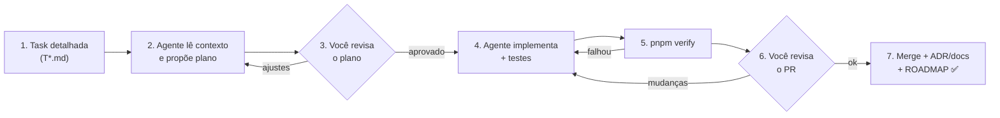

# Fluxo de Trabalho com IA

Guia **para humanos** de como o boilerplate é construído (e depois estendido) com agentes de IA. A versão operacional para o agente é a skill [`execute-roadmap-task`](../.agents/skills/execute-roadmap-task/SKILL.md).

## Visão geral

## Papéis

| Quem | Faz |
|---|---|
| **Você** | Decide ADRs, aprova planos, revisa o diff no git, faz os commits e o merge |
| **Agente** | Detalha tasks, propõe ADRs, planeja, implementa, testa, atualiza docs e sugere a mensagem de commit (nunca commita direto) |
| **Máquina** (lint, tsc, dependency-cruiser, testes, CI) | Reprova violações objetivas sem depender de revisão humana |

## Passo a passo

### 0. Antes de uma fase começar
- Resolva os ADRs que a bloqueiam (coluna "Bloqueia" em [decisions/README.md](./decisions/README.md)).
- Peça ao agente: *"detalhe as tasks da Fase N"* (skill [`detail-task`](../.agents/skills/detail-task/SKILL.md)). Revise os arquivos `T*.md` gerados, principalmente os **critérios de aceite** e o **fora de escopo**.

### 1–3. Plano (o ponto de revisão mais barato)
Abra uma **sessão nova** e peça: *"execute a task T1.03"*. O agente responde com um plano contendo: arquivos a criar/alterar, abordagem, testes previstos, riscos e decisões pendentes.

**O que olhar no plano:**
- [ ] Respeita as camadas e os ADRs?
- [ ] Está dentro do escopo (nada além da task)?
- [ ] Os testes previstos cobrem os critérios de aceite?
- [ ] Surgiu alguma decisão que deveria virar ADR?

### 4–5. Implementação
O agente implementa e roda `pnpm verify` até ficar verde. Se travar em algo fora do escopo, ele para e pergunta.

### 6. Review do PR
Use o checklist do [template de PR](../.github/pull_request_template.md). Mire em PRs de **até ~400 linhas** (sem contar lockfile e código gerado). Se ficar maior, a task deveria ter sido quebrada; registre isso para as próximas.

### 7. Fechamento
Merge → ROADMAP atualizado → ADRs com status final → skills/docs atualizados se algum padrão mudou.

## Definition of Done

Uma task só está pronta quando **todos** os itens valem:

1. `pnpm verify` passa (lint, typecheck, arch:check, testes unit; int/e2e quando a task tocar infra).
2. Cada critério de aceite da task está atendido e marcado.
3. Testes novos cobrem o comportamento (domínio: unit; repositórios/projectors: integração; endpoints: e2e).
4. Nenhuma regra do `AGENTS.md` violada; nenhuma exceção nova de lint/arquitetura sem ADR.
5. Se houve decisão: ADR criado e índice atualizado.
6. Se algo mudou: spec do módulo, [catálogo de eventos](./events/catalog.md), [glossário](./glossary.md), chaves i18n (`en` + `pt-BR`), skills e `AGENTS.md` atualizados.
7. `docs/roadmap/ROADMAP.md` com status atualizado e link do PR.

## Boas práticas que aumentam a assertividade

- **Sessão nova por task.** Contexto limpo é melhor que histórico longo.
- **Contexto mínimo e explícito.** A task lista os docs necessários; o agente não lê "tudo".
- **Exemplo > descrição.** A partir da Fase 6, aponte para código de referência real (`src/modules/iam/...`).
- **Enforcement > documentação.** Se uma regra foi violada duas vezes, ela deve virar regra de lint/arquitetura/teste.
- **Feedback vira conhecimento.** Corrigiu o agente em review? Atualize o `AGENTS.md`, a skill ou o doc no mesmo PR para não repetir o erro.
- **Decisões nunca ficam só no chat.** Se foi decidido conversando, vira ADR.

## Convenções de Git

- Branch: `task/T1.03-vitest-setup`
- Commits: Conventional Commits em inglês (`feat(iam): add register user command`)
- PR: título `T1.03 — Vitest setup`, corpo no template

